# FS25 UFO 2000 – fliegende Untertasse mit Kornkreis-Generator

Elf Mods für **Farming Simulator 25**:

| Mod | Was es ist |
| --- | --- |
| **`dist/FS25_UFO2000.zip`** | Die fliegende Untertasse im Simpsons-Look – **hohe, schmale Glaskuppel** mit Cockpit und HUD, acht Strahl-Modi, 5-Mio.-l-Füllgut-Laderaum, separater Ein-Objekt-Traktorstrahl (bis 12 t / 4,5 × 4 × 8 m) und Ernte-Zweitstrahl |
| **`dist/FS25_Alien.zip`** | **Drei** Aliens als aufstellbare Deko – der kleine grüne Kumpel, der Große mit Riesenschädel und Glubschaugen und **Captain Zorp** aus dem Cockpit-Blueprint (Fliegerhelm mit Brille auf der Stirn, Fluganzug, Namensschild) |
| **`dist/FS25_Disco.zip`** | **Hofdisco** mit Neon, Spiegelkugel, DJ-Pult und 6 eigenen Stücken – im Multiplayer hören alle in der Halle **denselben Song zur selben Zeit** |
| **`dist/FS25_Autokino.zip`** | **Autokino** mit 13-m-Leinwand und drei kurzen Zeichentrickfilmen samt Soundtrack – Bildnummer aus der Netzwerkzeit, also im MP frame-genau synchron |
| **`dist/FS25_UFO4500.zip`** | **Mähdrescher-UFO** mit 6-m-Schneidwerk, 15.000-l-Korntank und allem, was ein Drescher können muss |
| **`dist/FS25_Hoehensturm.zip`** | **Höhensturm** – PC-only Inversions-Achterbahn mit 2×2-Multiplayerwagen, manueller Dispatch, Glasbahnhof, LED-Tunneln und eigener Soundkulisse |
| **`dist/FS25_BabaJaga.zip`** | **Baba Jagas Hühnerhütte** – Blockhütte auf echtem Hühnerbein, als vollwertiger Hühnerstall, **ohne Lua** (konsolen-tauglich) |
| **`dist/FS25_BabaJagaHouse.zip`** | **Baba Jagas Wohnhütte** – separates Haus mit begehbaren Stufen und Balkon, Tür, Schlaf- und Garderoben-Trigger; ohne Lua |
| **`dist/FS25_CropHarvester.zip`** | **UFO 01 Crop Harvester** – kompakte Untertasse mit Glaskuppel und Captain Zorp, acht Strahl-Modi, 1.000.000-l-Korntank, registrierte Fülltypen und separater Ein-Objekt-Traktorstrahl |
| **`dist/FS25_Distillery.zip`** | **Club „Distillery Leipzig"** – Halle mit Bühne, großen PA-Türmen, Lichtanlage und DJ-Pult; die Titelliste hängt sichtbar an der Wand, **jeder Spieler** darf am Pult umschalten, und alle hören im MP denselben Song (auch das Spielradio ist als Quelle wählbar) |
| **`dist/FS25_UFO2500.zip`** | **Konsolen-Edition ohne eine Zeile Lua** – dasselbe UFO, Cockpit 20 m über dem Feld, rollt auf zwei breiten unsichtbaren Rädern, drückt mit einem 0,5 – 7,5 m breiten Pinsel Kornkreise ins Getreide und **landet auf Tastendruck** |

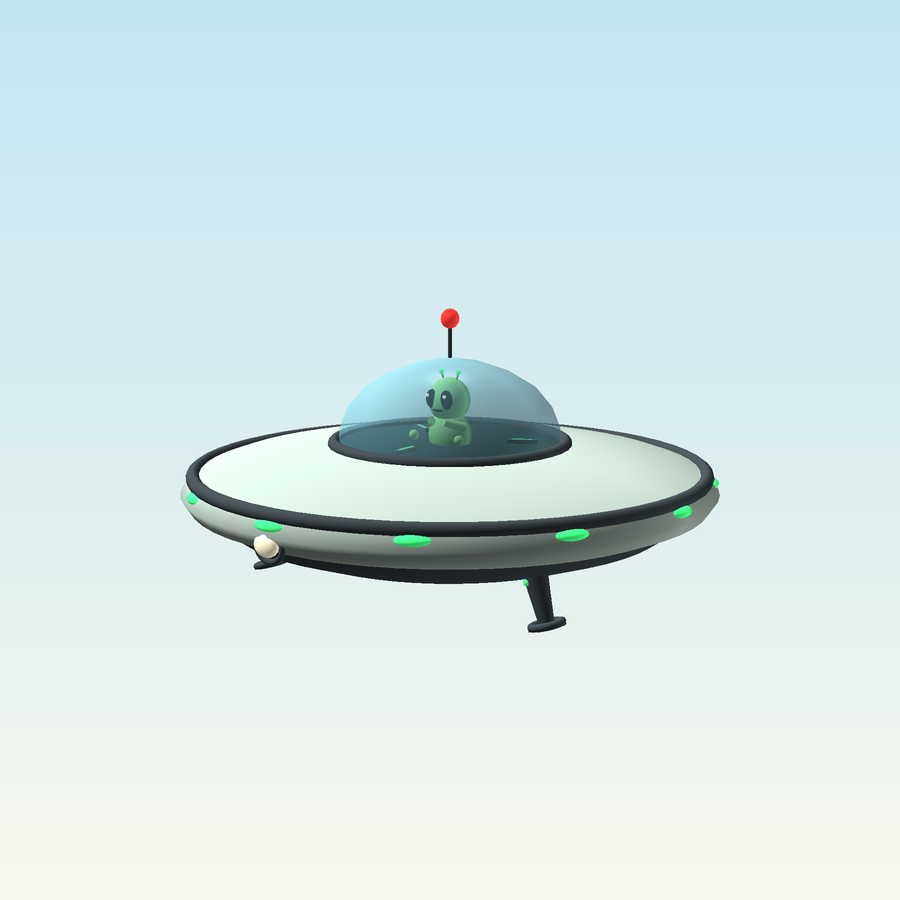

| Mod | PC / Mac | Xbox / PlayStation |
| --- | --- | --- |
| UFO 2000 | ✅ fliegen, 8 Arbeits-Modi, Füllgut- und physischer Traktorstrahl, Cockpit | ❌ eigener Lua-Code |
| Alien-Maskottchen (3 Figuren, inkl. Captain Zorp) | ✅ | ⚠️ möglich (nur noch über ModHub einreichen) |
| UFO 2500 | ✅ | ✅ **kein Lua, nur Grundspiel-Technik** |
| Hofdisco | ✅ Musik, Titelwahl, MP-Sync | ❌ eigener Lua-Code |
| Autokino | ✅ drei Filme, MP-Sync | ❌ eigener Lua-Code |
| Crop Harvester | ✅ acht Strahl-Modi, Kornkreise, beide Ladungsarten, Cockpit | ❌ eigener Lua-Code |
| Höhensturm | ✅ Inversionen, Multiplayerwagen, automatisch volle Runde | ❌ eigener Lua-Code |
| Distillery-Club | ✅ MP-synchrone Playlist, Radioquelle | ❌ eigener Lua-Code |
| Baba Jaga Wohnhütte | ✅ native Schlaf-/Garderoben-Trigger, animierte Tür, Stufen und Balkon | ✅ **kein Lua** |

---

## 1. Installation

1. Die ZIPs (oder nur die, die du willst) **unverändert** in den Mods-Ordner legen:
   - Windows: `Dokumente\My Games\FarmingSimulator25\mods\`
   - macOS: `~/Library/Application Support/FarmingSimulator25/mods/`
2. Spiel starten, im Hauptmenü unter **Mods** die Häkchen setzen.
3. UFO 2000: am Händler unter **Fahrzeuge → Autos** für 42.000 € kaufen.
   UFO 2500: ebd. unter der Marke **Lizard** für 38.000 €.
   Alien: unter **Platzierbare Objekte → Deko** – Maskottchen 750 €,
   der Große 1.200 €, Captain Zorp 1.500 €.
   Crop Harvester: am Händler unter der Marke **CropHarvester** für 96.000 €.
   Hofdisco / Autokino: unter **Platzierbare Objekte** für 32.000 € / 48.000 €.
   Baba Jagas Wohnhütte: separat unter **Farmhäuser** für 28.500 €; sie ersetzt
   den Hühnerstall nicht. Höhensturm: unter **Platzierbare Objekte** für
   1.650.000 €; dafür etwa 180 × 370 m freie Fläche einplanen.
   (UFO 2000 und UFO 2500 sind zwei eigenständige Mods – nimm das, was dir
   gefällt, oder beide.)

Keine weiteren Mods nötig; jeder Mod ist eigenständig. Hühnerhütte und
Wohnhütte sind zwei getrennte Placeables und können beide aufgestellt werden.

## 2. Steuerung – alles über die normalen Spiel-Optionen

Flug und Strahl-Grundfunktionen verwenden die normalen Fahrzeugaktionen.
Zusätzliche Tasten steuern Modi und virtuelle Ladung; alle Zustände erscheinen
im HUD und im anklickbaren Bordmenü.

| Was | Taste (Standard) | Kommentar |
| --- | --- | --- |
| Abheben / Landen | `V` („Gerät absenken") | ist auch auf jedem Gamepad/Joystick belegt |
| Steigen / Sinken | Frontladerarm-Achse (`Joystick`) oder `Bild ↑` / `Bild ↓` | analog, also stufenlos |
| Traktorstrahl an/aus | `Z` („Gerät extra") | startet/stoppt den gewählten Arbeitsmodus |
| Bordmenü | `M` | Muster und Modi anklicken; zeigt die aktuellen Einstellungen |
| Strahl-Modus | `K` | schaltet durch alle acht Modi |
| Strahlbreite / Saatgut | `J` / `L` | Breite ändern, im Sä-Modus Saatgut wechseln |
| Virtuelle Ladung abladen | `U` | Anhänger oder Abkippstelle |
| Physisches Objekt aufnehmen | `O` | ein geeignetes Fahrzeug / Objekt unter dem aktiven Strahl |
| Zweitstrahl Ernte → Anhänger | `B` | füllt im Erntemodus einen Anhänger / LKW unter dem zweiten Strahl |
| Korntank endlos | `I` | Tankgrenze an / aus |
| Vorwärts / Rückwärts | `W` / `S` (Gas/Bremse) | wie beim Traktor |
| Lenken | `A` / `D` | dreht das UFO um die Hochachse |
| Hupe | Hupe | das UFO grüßt |
| Kamera | `C` | außen / innen |

Alles davon lässt sich unter **Optionen → Steuerung** umbelegen (Suche nach
„UFO"). Tastenbelegungen mit `Bild ↑/↓` sind nur die bequeme Tastatur-Variante
der Achse.

## 2b. Acht Arbeits-Modi, zwei Ladungssysteme, Cockpit

Das UFO 2000 arbeitet wie eine ganze Maschinenkette – **ohne dass
irgendetwas sichtbar angekoppelt wird**. Füllgut bleibt im virtuellen Laderaum;
Fahrzeuge und lose Gegenstände werden separat einzeln am Traktorstrahl getragen.

| Taste | Was passiert |
| --- | --- |
| **K** | nächster Strahl-Modus (die 8 Modi im Kreis) |
| **J / L** | Strahl enger / weiter – **0,50 m** bis **16 m** (im Sä-Modus: Saatgut wechseln) |
| **Z** | Strahl an / aus – der Strahl *macht* die Arbeit |
| **M** | Cockpit-Menü: Muster, Modi und Einstellungen – **mit der Maus klickbar** |
| **O** | ein physisches Objekt unter dem aktiven Strahl aufnehmen (hovern) |
| **U** | gehaltenes Objekt nahe der sicheren Mindesthöhe freigeben; sonst Füllgut abladen |
| **B** | Ernte-Zweitstrahl an/aus: während des Erntens direkt in Anhänger/LKW fördern |
| **I** | Korntank unendlich an/aus |
| **V**, `Bild ↑/↓`, `W/A/S/D` | abheben/landen, Höhe, fliegen – wie vorher |

### Die acht Modi

| # | Modus | Strahl-Farbe | Was er macht |
| --- | --- | --- | --- |
| 1 | **Plattdrücken** | rot, pulsierend | Kornkreise in 10 Mustern, keine Ernte |
| 2 | **Ernten** | sattgrün | schneidet die Frucht, Korn in den Tank |
| 3 | **Grubbern** | bernstein | grubbert den Boden (Stoppel wird eingearbeitet) |
| 4 | **Pflügen** | orange | pflügt, inkl. Pflug-Level |
| 5 | **Säen** | hellgrün | sät das gewählte Saatgut (J/L wechselt die Frucht) |
| 6 | **Düngen** | violett | bringt Düngestufe 1 auf die Fläche |
| 7 | **Aufnehmen** | hellblau | saugt Anhänger/Ladung in den Laderaum („beam me up") |
| 8 | **Abladen** | türkis | schüttet den Laderaum nach unten aus |

Technisch sind das genau die Funktionen, die auch die Original-Maschinen
benutzen (`cutFruitArea`, `updateCultivatorArea`, `updatePlowArea`,
`updateSowingArea`, `updateSprayArea`) – der Acker sieht danach genauso aus wie
nach echter Arbeit, inklusive Feldstatus, Spuren und Wachstumsstufen. Jeder
Modus hat seinen **eigenen Leuchtkegel**, seine **eigene Lichtfarbe**, sein
**eigenes Summen** und seine eigene Anzeige im Cockpit. Von außen ändert sich
nur Farbe, Blinken und Ton – das UFO selbst bleibt nackt.

### Virtueller Laderaum

Der Laderaum (Füllstand 3) fasst **5.000.000 l** und akzeptiert alle beim Spiel
registrierten Fülltypen – einschließlich solcher aus Mods: Getreide, Häckselgut,
Heu, Silage, Dünger, Kalk, Wasser, Milch und mehr. Er transportiert Füllgut in
Füllbehältern. Physische Objekte verwenden den separaten Traktorstrahl unten.

* **Aufnehmen:** mit Modus 7 **über** einem vollen Anhänger schweben (mindestens
  1,8 m Abstand, damit nichts kollidiert) und **Z** drücken – der Strahl saugt
  die Ladung mit 6.000 l/s hoch.
* **Abladen:** mit Modus 8 über Anhänger **oder** Abkippstelle schweben und
  **Z** drücken – 3.000 l/s gehen nach unten. Erst läuft der Korntank leer,
  dann der große Laderaum.
* **Beim Ernten direkt abgeben:** **B** einschalten und einen Anhänger oder
  LKW unter den schmalen Zweitstrahl stellen. Der grüne Hauptstrahl erntet
  weiter, während der rote Zweitstrahl den Korntank in den Ziel-Füllbehälter
  entleert. Das HUD zeigt, ob ein Ziel erkannt wurde.
* Ein ganzes Feld am Stück ernten ist damit kein Problem: der Tank läuft nicht
  mehr über, und mit **I** ist sogar die Tankgrenze abgeschaltet.

### Physische Ladung (separat vom virtuellen Füllgut)

Mit **O** kann das schwebende UFO bei aktivem Hauptstrahl genau **ein dynamisches
Objekt** aufnehmen: geeignete Fahrzeuge, abgekuppelte Geräte, Paletten, Ballen,
lose Stämme und ähnliche Gegenstände. Abmessungen und Masse werden vor dem
Anheben geprüft; die statischen Limits sind **12.000 kg** und **4,5 × 4 × 8 m**.
Angehängte Geräte, bemannte oder nicht messbare Objekte werden abgewiesen.

* Der Strahl muss aktiv sein; zum Aufnehmen erst schweben und höchstens 18 m
  über dem Boden stehen. **O** wählt das nächste geeignete Objekt darunter.
* **U** löst das Objekt kontrolliert auf niedriger Höhe. Mit gehaltener Ladung
  lässt sich das UFO nicht landen; zuerst mit **U** absetzen.
* Die Ladung folgt unter der Untertasse und ihre Physik wird beim Freigeben
  wiederhergestellt. Beim Löschen des UFOs wird ein Not-Absetzen versucht.
* Die Implementierung ist statisch geprüft, aber noch nicht in einer laufenden
  FS25-Instanz validiert; besonders Masse-/Bounds-Schätzung, Multiplayer-Sync
  und Kollisionen müssen im Spiel getestet werden.

### Cockpit

Unter der hohen, schmalen Glaskuppel sitzt du in einem richtigen Arbeitsplatz:
geschwungene Konsole mit zwei Instrumentenflügeln, ein **Modus-Wahlrad** mit
acht leuchtenden Segmenten und einer Nadel, die auf den gewählten Modus zeigt,
Schalterreihen, Steuerknüppel, ein Leuchtenkranz über dem Kopf, eine Kaffeetasse
und ein **Wackel-Alien** auf der Feder. Der Blick nach vorn bleibt frei – durch
die Kuppel siehst du Feld und Horizont.

Mit **M** öffnest du das Bordmenü: links die Bodenmuster, rechts die acht
Modi, darunter die Tank- und Zweitstrahl-Schalter. Muster und Modi werden beim
Auswählen sofort aktiv. Alles ist **mit der Maus anklickbar**; `Bild ↑/↓`
wählt das Muster, `K` wechselt den Modus, `J/L` stellt Breite/Saatgut ein,
`B` schaltet den Ernte-Zweitstrahl, `I` den Endlos-Tank, `O` den Objektstrahl
und `U` das Freigeben/Abladen.

> Die Smoke-Tests `tools/ufo/luatest.py` und `tools/ufo/luatest_crop.py`
> prüfen Flug, alle acht Modi, Feldarbeit, universelle Fülltypen, direkten
> Erntetransfer, Tank, Laderaum, Cockpit-Anzeigen und Sounds – ohne Spiel.

## 3. Fliegen

- **Abheben:** `V` – die Beine klappen ein, das UFO schwebt auf etwa 3 m und
  **bleibt von allein in der Luft stehen**, ohne dass du etwas halten musst.
- **Höhe:** Joystick-Achse oder `Bild ↑/↓` – stufenlos bis **120 m** über Grund.
  Das UFO folgt weich und wiegt leicht.
- **Fliegen:** `W`/`S` bis ca. **31 km/h**, `A`/`D` dreht. Beim Fliegen neigt
  sich die Untertasse leicht in die Richtung.
- **Landen:** `V` oder ganz nach unten steuern – das UFO sinkt, die Beine
  fahren aus, es steht wieder normal am Boden. Der Strahl geht dabei aus.
- **Sound:** weicher Schwebe-Sound mit kleinen „Blubber"-Tönen, drei
  Drehzahl-Ebenen, Start/Stopp-Sweep und eine fröhliche Alien-Melodie als Hupe
  (Hörprobe: `docs/sound_demo.ogg`).

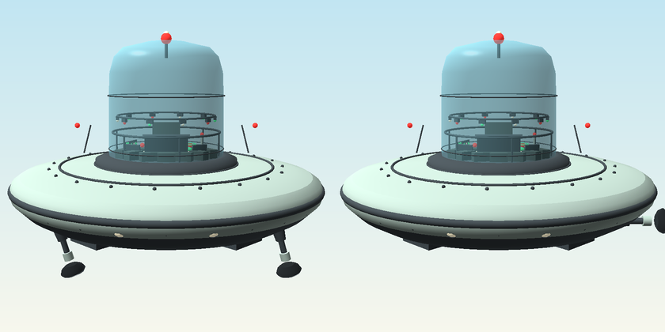

## 4. Kornkreise ins Feld drücken

1. Über das Feld fliegen und mit `V` abheben.
2. `M` öffnet das **Bordmenü** – dort stehen neun Geometrien plus der **manuelle
   Modus** zur Auswahl.
3. Mit `Bild ↑ / ↓` (bzw. der Achse) das Muster wählen, mit `Z` anwenden.
4. Der Traktorstrahl fährt auf, ein Ring am Boden wächst auf die Zielgröße, und
   die Pflanzen darunter werden **von der Mitte nach außen plattgedrückt** –
   genau in der gewählten Form, ohne dass ein Mähdrescher drüberfahren muss.

Es wird **nichts gemäht**: die Ernte bleibt stehen, wird aber zerdrückt. Genau
das macht das Spiel auch, wenn ein Fahrzeugreifen über ein Feld rollt – die
Pflanzen sind platt, der Ertrag an der Stelle ist weg, das Feld selbst bleibt
unverändert. Das ist der Effekt `updateWheelDestructionArea` aus dem Basisspiel
und funktioniert damit auch bei allen Fruchtarten.

Der **Radius ergibt sich aus der Flughöhe**: der Strahl endet immer genau am
Boden, sein halber Öffnungswinkel beträgt 34°. Bei 10 m Höhe sind das ca. 6,7 m
Radius, bei 40 m ca. 27 m (gedeckelt bei 70 m). Die Formskala ist der Strahl,
die Größe stellst du also einfach mit der Höhe ein. Das HUD zeigt während des
Fluges Höhe, gewähltes Muster und aktuellen Radius.

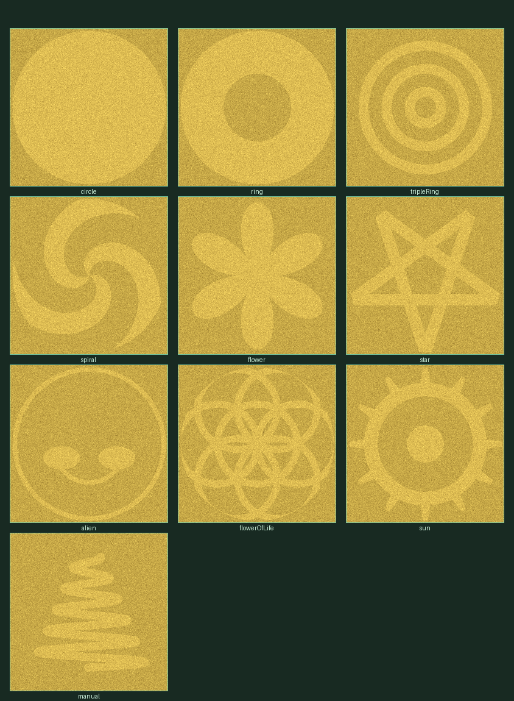

Muster: Kreis · Ring · Drei Ringe · Spirale · Blüte · Stern · Alien-Gesicht ·
Blume des Lebens · Sonne · **Manuell**

### Manueller Modus (50-cm-Stift)

Im manuellen Modus öffnet sich der Strahl nicht zum Kegel, sondern bleibt zu
einem **dünnen Strich von ca. 50 cm Durchmesser** gebündelt, der senkrecht auf
den Boden zeigt. Du fliegst einfach los und „malst" dabei: alle ~22 cm setzt das
UFO einen 50-cm-Stempel in die Ernte, dazwischen interpoliert das Spiel. So
kannst du eigene Formen, Buchstaben, Pfeile oder Spiralen in ein Feld ziehen –
langsam fliegen = feine Linie, schneller = grober Strich. Stehen bleiben setzt
keine weiteren Stempel, du kannst also in Ruhe neu ansetzen.

### Spuren beim Start und bei der Landung

Jedes Abheben und Aufsetzen drückt einen **kreisrunden Fleck von ca. 3,8 m
Durchmesser** in die Ernte darunter, dazu je Landebein einen kleinen Abdruck.
Das passiert nur, wenn tatsächlich Frucht unter dem UFO steht – auf Wiese,
Straße oder Hof passiert nichts. Wer auf seinem Feld landet, sieht danach
also die Untertasse stehen, wo sie stand. 🙂

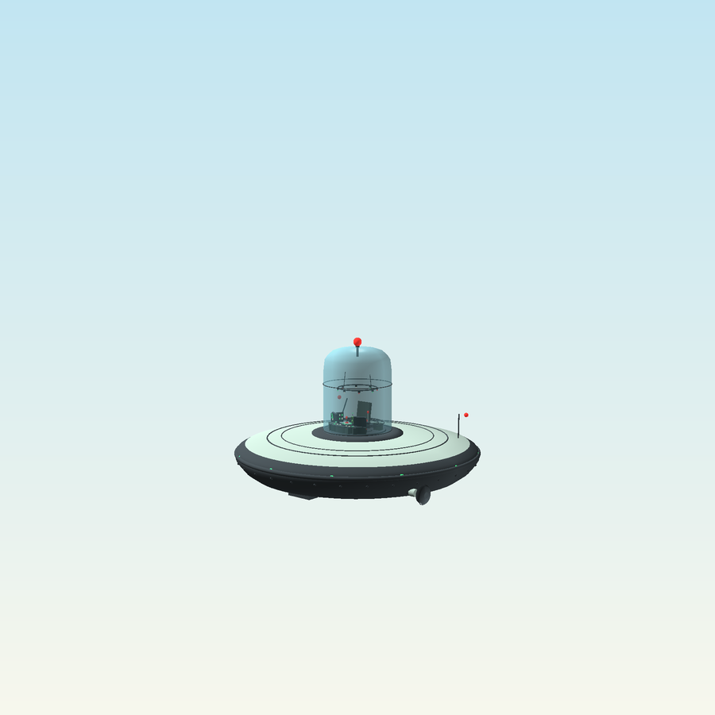

### Der Strahl bewegt sich (neu)

Der Kegel ist keine starre Folie mehr. In jedem Strahlknoten stecken jetzt vier
Teile, die das Skript jede Sekunde animiert (`UFO2000.updateBeamFx`):

* **Kern** – ein schmaler weißer Innenkegel („High-Intensity-Kern“ aus dem Blatt).
* **Helix** – ein spiralförmiges Band, das sich mit 90°/s dreht; dadurch wandert
  Struktur durch den ganzen Kegel, auch wenn man still steht.
* **vier Ringe** – flache Ringe, die mit 3,2 Ringen/s von der Bordwand zum Boden
  wandern und dabei auf den Kegelradius an ihrer Höhe skaliert werden
  (`setScale(ring, y, 1, y)`); sie beschleunigen nach unten wie etwas, das fällt.
* **Licht** – die Strahl-Lampe bekommt die Modusfarbe und pulsiert mit 2,6 Hz.

Das läuft auf Server und Clients (die Zeit kommt aus `onUpdateTick`), ist pro
Modus eigenständig und kostet nur ein paar `setTranslation`/`setScale`-Aufrufe
pro Frame. Echte Partikelsysteme (`ParticleSystem`) setzt der Mod bewusst nicht
ein: die lassen sich ohne laufendes Spiel nicht prüfen, und ein falsch
verdrahtetes Partikelsystem sieht schlimmer aus als gar keins. Der Nebel-Effekt
kommt über die transparenten Strahlflächen und die wandernden Ringe.


## 5. Was drin ist

**UFO 2000**
- Modell: 12.700 Dreiecke, 12 Shapes – Rumpf, große Glaskuppel mit Sitz für
  deinen Charakter, Konsole, drei einfahrbare Beine, Leuchtenkranz, Drehlicht,
  Strahlkegel, Bodenring
- 6 Lichter (Abblendlicht links/rechts, Arbeitslicht, Strahl, Drehlicht,
  Rücklicht), 2 Kameras
- `scripts/UFO2000.lua`: Flug-Specialization mit Server-Autorität,
  Multiplayer-Sync, Achsen-/Tasten-Eingabe, Kornkreis-Raster und HUD-Menü
- 7 selbst erzeugte OGG-Sounds, DDS-Texturen, Shop-Icon, Brand-Logo
- Deutsch + Englisch

**UFO 2500 (Konsole)**
- dasselbe Modell (15.200 Dreiecke), aber **kein Lua, kein `scripts/`-Ordner**
- **20 m** vom Boden bis zum Scheitel – Cockpit auf 20,00 m, Rumpf schwebt auf
  18,83 m
- 19 unsichtbare Räder: **zwei breite Räder (0,70 m)** als Fahrwerk, zwei
  winzige Stützräder gegen Umkippen, 15 Pinsel-Räder für die Frucht
- 4 Radkonfigurationen als Pinselbreite (0,5 / 1,5 / 3,5 / 7,5 m)
- **Landung ohne Skript**: Grundspiel-`foldable` + i3d-Animation fährt das
  Cockpit in 4,5 s auf 0,95 m herunter, Beine klappen aus, Strahl wird zum
  Landefleck
- Cockpit mit Konsole, Sitzen und **zwei blinkenden Leuchten** (Grundspiel-
  `BeaconLight`), Kameras innen/außen
- Strahl und Bodenring als feste Geometrie, Bodenlicht, Sounds
- Marke `Lizard`, Deutsch + Englisch

**Hofdisco**
- 5.100 Dreiecke, 18 Shapes – Halle, Giebel mit Pixel-Neonschrift, Schachbrett-
  Tanzfläche, DJ-Pult, vier Boxentürme, Theke, Tische, drehende Spiegelkugel,
  drei Lichtgruppen mit je einer echten Punktlicht-Quelle
- `scripts/Disco.lua`: Playlist, Server-Autorität, Dirty-Flag-Sync,
  Startzeit-basierte Wiedergabe, Tastenbelegung im Spiel neu belegbar
- 6 selbst erzeugte OGG-Stücke, 18 Texturen, Shop-Icon

**Autokino**
- 3.200 Dreiecke, 13 Shapes – Leinwand auf Stahlrahmen, Vorführhäuschen mit
  Projektor, 24 Parkbuchten, Lampenmasten, Neonschild
- `scripts/Autokino.lua`: Filmwechsel, Pause, frame-genaue Wiedergabe aus der
  Netzwerkzeit, MP-Sync über Dirty Flags
- 3 Filme × 16 Bilder (DDS), 3 Soundtracks, 14 Texturen, Shop-Icon

**Alien-Maskottchen (drei Figuren)**
- Maskottchen ca. 25.000 Dreiecke, der Große ca. 26.000, Captain Zorp ca. 34.000
  (2026 neu modelliert, siehe `tools/alien/character.py` + `tools/ufo/sculpt.py`)
- je 2 Shapes (Mesh + unsichtbare Kollision), 17 Texturen
- Platzierbar, frei drehbar, wieder aufnehmbar, 750 / 1.200 / 1.500 €
- Maskottchen und der Große nach der Vorlage: großer Kopf, riesige glänzende
  Mandelaugen, dünne Ärmchen und Beine, **geringelte Socken** (einer rot, einer
  blau), rosige Wangen, schüchternes Lächeln, Fühler mit Leuchtkugeln
- Captain Zorp trägt Fluganzug, **weißen Fliegerhelm mit orangem Rand und
  Ohrmuscheln**, die schwarze Brille hoch auf die Stirn geschoben, dazu das
  „ZORP"-Namensschild – dieselbe Figur wie im Cockpit des Crop Harvester

### Feintuning

Flugwerte stehen oben in `FS25_UFO2000/scripts/UFO2000.lua`:

```lua
UFO2000.MAX_ALTITUDE   = 120.0   -- maximale Höhe über Grund
UFO2000.MIN_ALTITUDE   = 1.10    -- Schwebehöhe mit eingeklappten Beinen
UFO2000.CLIMB_SPEED    = 6.5     -- m/s auf der Höhenachse
UFO2000.YAW_SPEED      = 55.0    -- Grad/s beim Drehen
UFO2000.MAX_SPEED      = 8.5     -- m/s Horizontalflug (~31 km/h)
UFO2000.BEAM_HALF_ANGLE = 34.0   -- Öffnungswinkel des Strahls (= Radius/Höhe)
UFO2000.CIRCLE_CELL    = 0.35    -- Rasterfeinheit der gedrückten Form
UFO2000.MANUAL_RADIUS  = 0.25    -- Stift-Radius (50 cm Durchmesser)
UFO2000.LANDING_MARK_RADIUS = 1.9 -- Spurenfleck beim Start / bei der Landung
```

## 6. Selbst bauen (optional)

Alles ist per Python erzeugt, Blender ist nicht nötig:

```bash
python3 -m venv .venv
.venv/bin/pip install numpy pillow soundfile lxml luaparser lupa
.venv/bin/python tools/build_mod.py            # UFO: Modell, Media, Prüfung, ZIP
.venv/bin/python tools/alien/build.py          # Alien: Modell, Icon, Prüfung, ZIP
.venv/bin/python tools/ufo/validate.py         # nur prüfen
.venv/bin/python tools/alien/validate.py
.venv/bin/python tools/ufo/luatest.py          # Fluglogik ohne Spiel testen
.venv/bin/python tools/ufo/circle_preview.py   # Muster-Vorschau erzeugen
.venv/bin/python tools/build_console_mod.py    # UFO 2500 (Konsole): Modell, Media, ZIP
.venv/bin/python tools/build_rollercoaster_mod.py # Höhensturm (PC/Lua): Modell, Spline, ZIP
.venv/bin/python tools/coaster/luatest.py       # Inversions-Frame + Runden-/Ausstiegssperre testen
.venv/bin/python tools/ufo/validate2500.py     # Konsolen-Regeln prüfen
.venv/bin/python tools/ufo/brush_test.py       # Pinselbreiten nachrechnen
.venv/bin/python tools/ufo/brush_patterns.py   # Beispiel-Kornkreise rendern
.venv/bin/python tools/ufo/brush_preview.py    # Pinselbreiten-Diagramm
.venv/bin/python tools/ufo/console_preview.py  # Schnittzeichnung
```

Die Prüfskripte kontrollieren die Mod-XMLs gegen die FS25-Schemas (modDesc,
vehicle, placeable, i3d 1.6), i3dMappings, l10n-Keys, Lua-Syntax und ZIP-Inhalt.
`tools/coaster/luatest.py` prüft zusätzlich beide invertierten Rahmen, die
nahtlose Stationsausrichtung sowie Start-, Vollrunden-, Bremssperr- und
Aussteigelogik der Achterbahn.

## 7. Konsole (Xbox / PlayStation) – so geht es doch: das UFO 2500

Auf Konsolen sind eigene Lua-Skripte verboten („Mods must not contain any extra
lua scripts"), deshalb ist das fliegende **UFO 2000** PC-only. Für das **UFO
2500** ist die Fliegerei aber gar nicht nötig – es benutzt nur, was das
Grundspiel ohnehin mitbringt:

```
                        .-'-.
       20 m ----→   .'  Cockpit  '.      <- dein Charakter sitzt auf 20,00 m
      (Sitz)       /  (Glaskuppel)  \    <- Rumpf schwebt auf 18,83 m
                  |==================|
                   \__  Strahl  __/      <- feste Geometrie, endet am Boden
                      |  |  |  |          <- 15 unsichtbare Pinsel-Räder à 0,5 m
       0,95 m ----→  ==O=======O==        <- 2 breite unsichtbare Räder (0,70 m)
                     ^         ^
                  Landung: Cockpit fährt hier herunter, Beine stützen
```

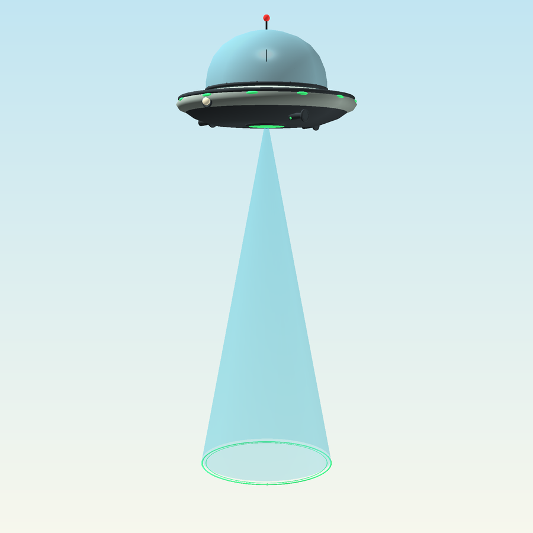

**Der Trick:** Das Fahrzeug ist ein stinknormales `baseDrivable`-Fahrzeug – nur
mit **unsichtbaren Rädern**. Zwei breite Räder (0,70 m, wie ein Motorrad, bloß
fett) stehen vorn und hinten am Boden (Radradius 0,55 m), zwei winzige
Stützräder links und rechts verhindern das Umkippen. Das eigentliche UFO ist als
Modell 18,83 m darüber montiert. Der Fahrzeug-Ursprung bleibt am Boden, also
funktionieren Physik, Kamera, Ein-/Aussteigen, Shop und Spawn genau wie bei
einem Traktor – nur dass oben eine Untertasse hängt und darunter „Luft statt
Räder" ist. Genau das, was du beschrieben hast: ein 20 m hohes UFO ohne Aufbau
unter dem Cockpit.

**Landen ohne Skript:** Die Landung ist eine i3d-Animation, die das Grundspiel
abspielt. Das UFO hat dafür eine `foldable`-Konfiguration „Landung": Taste **X**
(Gamepad: Gerät ausklappen) startet sie. In 4,5 Sekunden fährt das Cockpit von
20,00 m auf **0,95 m** herunter – fast Straßenniveau –, die drei Beine klappen
aus, der Strahl zieht sich zum Landefleck zusammen. Nochmal X und das UFO steigt
wieder auf. Du kannst also landen, aussteigen, einsteigen und weiterfliegen –
ohne eine Zeile Lua, nur mit `foldable` + `AnimatedVehicle` aus dem Grundspiel.

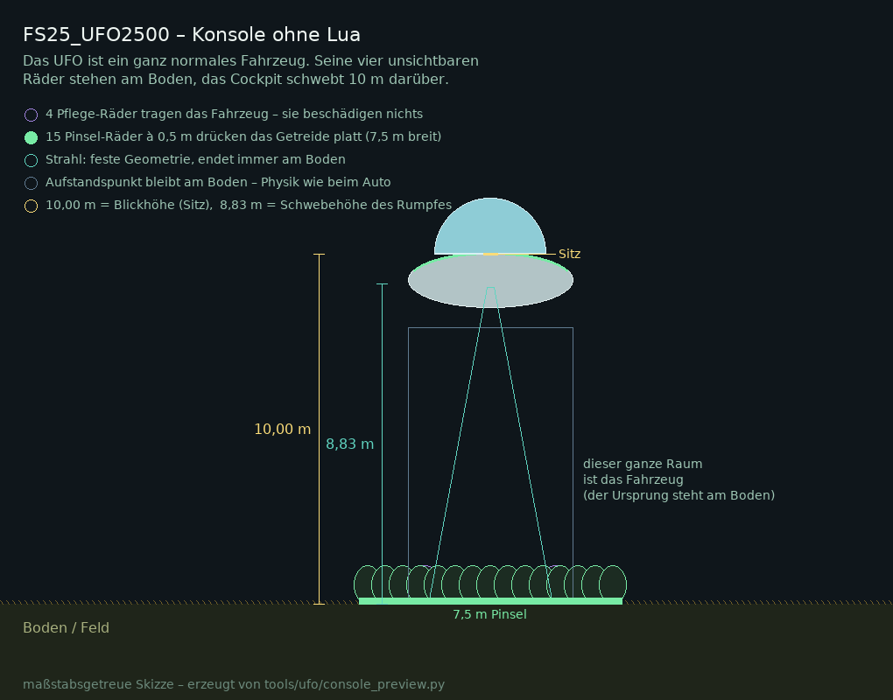

**Cockpit:** unter der Glaskuppel sitzen Konsole, Bildschirme, Schalter und zwei
kleine Leuchten. Die blinken über die Grundspiel-Komponente `BeaconLight`
(Rundumlicht-Taste), drehen sich und färben den Innenraum. Dazu wippt das ganze
UFO leicht, weil die unsichtbaren Räder federn – das verkauft das Schweben.

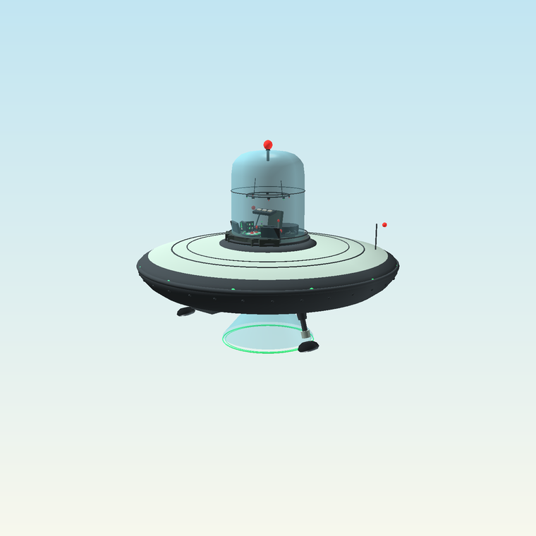

**Kornkreise ohne Skript:** Die Rad-Beschädigung des Grundspiels
(`WheelDestruction`) drückt pro Rad und Frame ein Rechteck von
`Breite × 0,5 m` in die Frucht. Das UFO 2500 hat deshalb unter der Mitte eine
**Reihe aus bis zu 15 unsichtbaren Rädern** („Pinsel"). Wie breit der Pinsel
ist, wählst du im Shop:

| Radkonfiguration | Pinsel | Fläche pro 100 m Fahrt | Wofür |
| --- | --- | --- | --- |
| **Stift** | 1 × 0,5 m | 50 m² | frei malen wie mit dem 50-cm-Stift im PC-Mod |
| **Ring** | 3 × 0,5 m = 1,5 m | 150 m² | kleine Kreise, Buchstaben |
| **Standard** | 7 × 0,5 m = 3,5 m | 350 m² | so groß ist der Bodenring unter dem UFO |
| **Mähdrescher** | 15 × 0,5 m = 7,5 m | 750 m² | eine Bahn und das Feld ist platt |

Weil die Stempel lückenlos aneinanderliegen, ist der Streifen exakt so breit wie
eingestellt (nachgerechnet in `tools/ufo/brush_test.py`: Kreis r = 15 m mit dem
Standard-Pinsel = 330 m² gedrückte Fläche, theoretisch 2π·r·b = 330 m²).

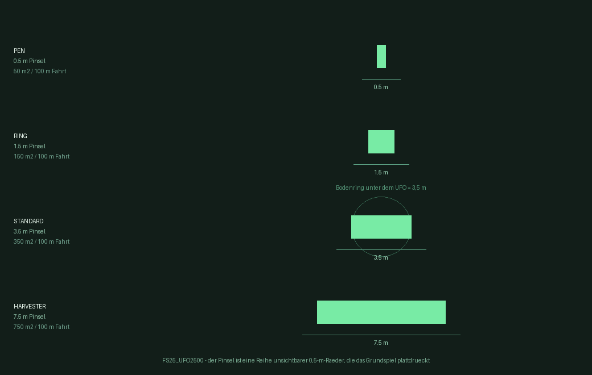

**Formen zeichnet man durch Fahren:** Kreis = einmal im Kreis fahren (der
Bodenring zeigt die Pinselbreite), Doppelring = außen rum, quer rein, innen rum,
Stern = gerade Bahnen. Kein Menü, keine Sondertaste, alles Gamepad-tauglich.

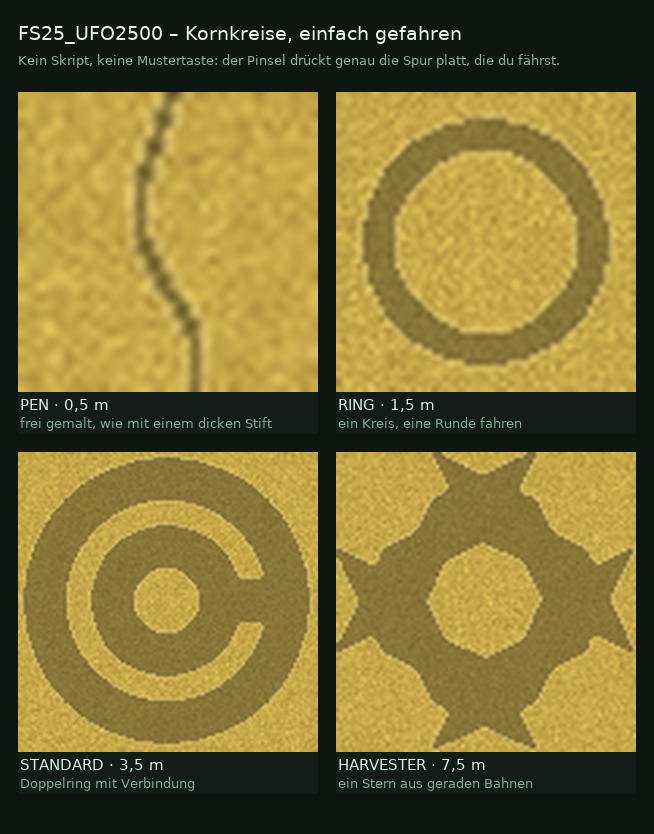

**Was auf Konsole fehlt** (ehrlich): Höhensteuerung im Flug, Muster-Menü, HUD,
Start-/Landespuren. Der Strahl ist feste Geometrie und immer an, das Arbeitslicht
(`L`) macht das grüne Leuchten am Boden. „Mähdrescher" heißt: die Ernte wird
zerstört (Ertrag weg, Pflanzen platt), geerntet wird nichts – für richtiges
Ernten gibt es die separate Mähdrescher-Variante.

**ModHub:** Das UFO 2500 ist genau dafür gebaut – kein `scripts/`-Ordner, keine
eigenen Skripte in `<specializations>` (nur Grundspiel-Code wie `foldable`),
keine `<actions>`, Marke `LIZARD` (Basisspiel). Damit sollte es den Konsolentest
überstehen; einreichen musst du es selbst (Konto auf farming-simulator.com,
TestRunner drüberlaufen lassen, ZIP hochladen).

## 8. Das große Strahlschiff: `FS25_UFO4500`

Das UFO 4500 erntet wie die UFO 01 **ausschließlich mit dem Traktorstrahl** –
kein Schneidwerk, kein Anbaugerät, kein Anhänger, keine Attacher-Joints. Ein
Shop-Artikel, ein Mod, ein Schiff.

| Was | Wert |
| --- | --- |
| Preis | 185.000 |
| Motor | 300 PS, 25 km/h, vier Hover-Turbinen am Rumpf |
| Strahl | 2 m bis 30 m breit (J/L), Arbeitshöhe 3 m bis 30 m |
| Korntank | 2.000.000 l, mit `I` auf unendlich |
| Größe | 1,3-fache UFO 01 (Rumpfdurchmesser ≈ 6,5 m) |

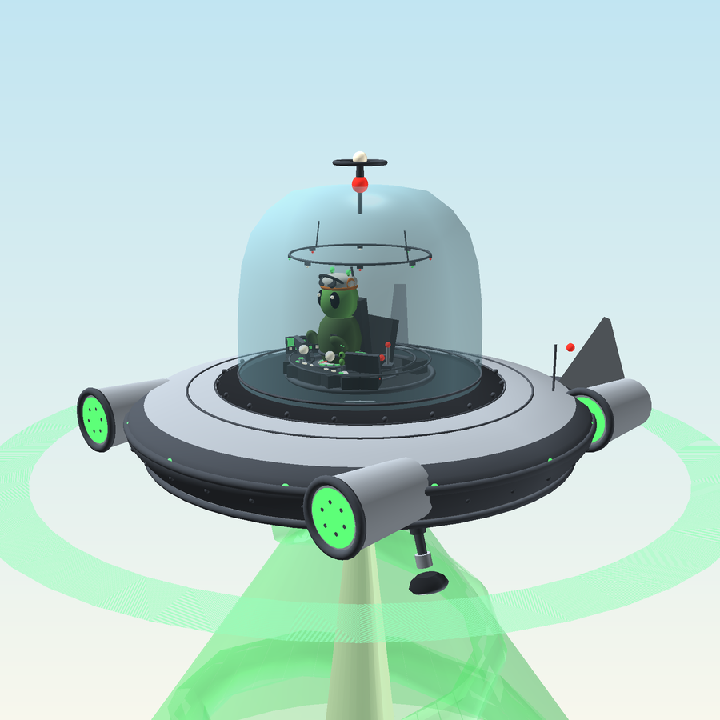

**So erntest du**

1. UFO 4500 kaufen (Kategorie Autos, Marke UFO-Werke).
2. Einsteigen, `V` = abheben. Die Landekufen klappen ein, das Schiff schwebt.
3. Mit `Bild auf` / `Bild ab` (oder der Joystick-Achse) auf 3–6 m Höhe gehen.
4. `K` bis **GRÜN – Ernten** im HUD steht, dann `Z` für den Strahl.
5. Über das Feld fliegen – das Korn geht ohne Verlust in den Tank, das Feld
   ist dahinter abgeerntet.
6. Abgeben mit `U` über Anhänger, Silo oder Abkippstelle.

Die anderen Modi machen den Rest der Feldarbeit: **BLAU** säen und düngen,
**VIOLETT** grubbern und pflügen, **GELB** Kornkreise plattdrücken, **ROT**
aufnehmen (Sog) und abgeben (Strahl). Das ist alles im Detail in
`docs/pdf/UFO4500.pdf` beschrieben.

**Bauen und prüfen**

```bash
python tools/build_harvester_mod.py                 # Modell -> XML -> Bilder -> ZIP
```

Der Build bricht ab, wenn im Fahrzeug-XML noch ein `<attacherJoints>`,
`jointType="cutter"`, `<combine>`, `<pipe>` oder eine `workArea` steht, wenn
ein vom Lua benutzter Knoten kein `i3dMapping` hat oder wenn eine l10n-ID in
`translation_de/en.xml` fehlt. Das Kiel-File des alten 6-m-Schneidwerks
(`model_harvester_header.py`, `ufo4500header.template.xml`) ist gelöscht – das
UFO 4500 hat kein Anbaugerät mehr.

## 8b. Der Ernte-Ufo: `FS25_CropHarvester` (UFO 01)

Das ist der Flieger aus dem Blueprint: eine kompakte Untertasse mit **einer
großen Glaskuppel**, in der Captain Zorp ziemlich eng hinter den Hebeln sitzt.
Kein Mähwerk, kein Anbaugerät – **alles macht der Strahl unter dem Bauch**.

Vom Blatt übernommen: **„CROP HARVESTER"** auf beiden Schultern und **„UFO 01"**
auf der Nase, zwei **dreieckige Heckflossen** am hinteren Rand, die
**Ringantenne** auf der Kuppel, LED-Reihen im Stoßfänger und die beiden
grünen Düsen am Heck.

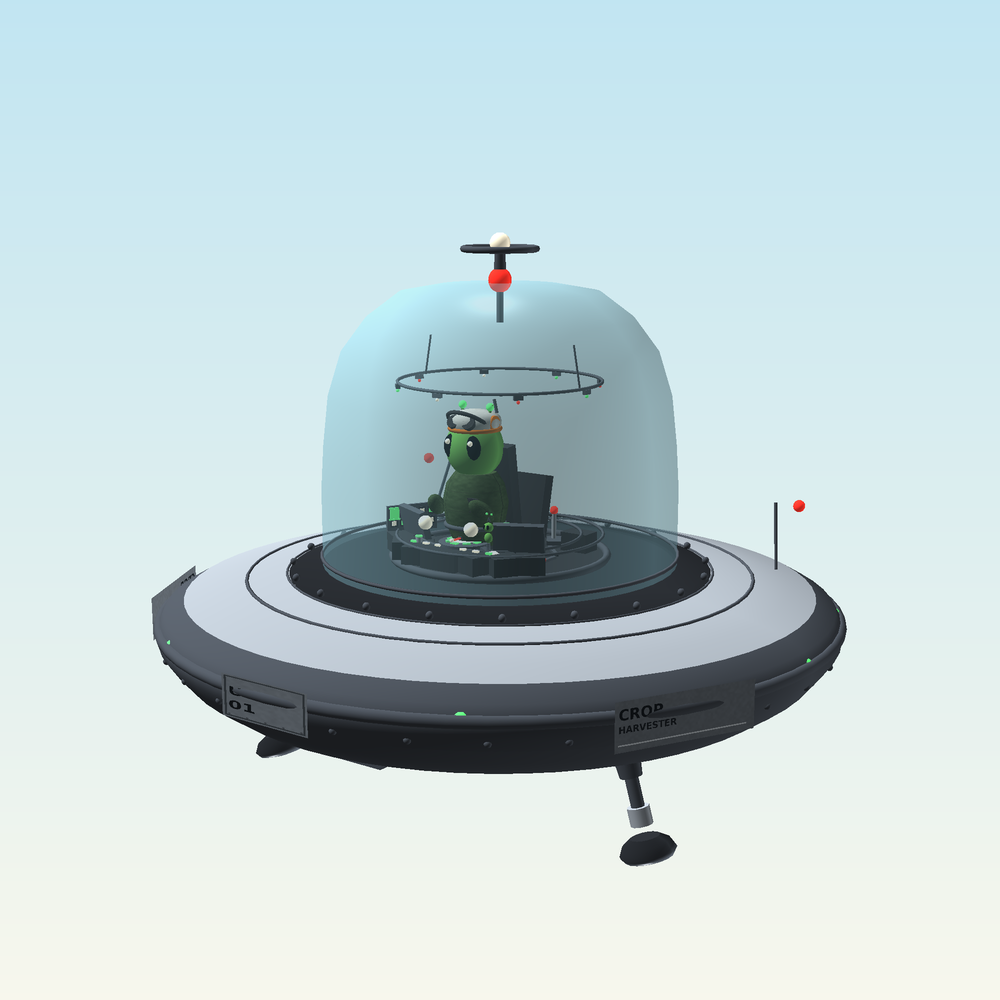

| Was | Wert |
| --- | --- |
| Arbeitsbreite | 6 m bis 30 m, stufenlos (Radius 3–15 m) |
| Strahl | 8 Modi, jeder mit eigener Farbe und eigenem Sound |
| Korntank | 1.000.000 l (der Blueprint sagt „praktisch unendlich") |
| Virtueller Laderaum | 5.000.000 l; nimmt registrierte Fülltypen an, getrennt vom physischen Objektstrahl |
| Schweben | 2 m bis 15 m, stufenlos |
| Preis | 96.000 € |

### Die acht Modi

| Menü-Nr. | Modus | Farbe | Was passiert |
| --- | --- | --- | --- |
| 1 | Plattdrücken / Kornkreise | **gelb** | drückt Muster ins Feld, ohne die Frucht zu ernten |
| 2 | Ernten | **grün** | schneidet die Frucht und füllt den Korntank |
| 3 | Grubbern | **violett** | bearbeitet den Boden |
| 4 | Pflügen | **violett** | pflügt die Fläche |
| 5 | Säen | **blau** | sät das gewählte Saatgut |
| 6 | Düngen | **blau** | bringt Dünger aus |
| 7 | Aufnehmen | **rot** | saugt Füllgut aus einem Anhänger in den Laderaum |
| 8 | Abladen | **rot** | entlädt Korntank oder Laderaum in Anhänger / Abkippstelle |

Im Erntemodus schaltet **B** einen zweiten roten Strahl zu: Er überträgt den
Korntankinhalt in den Füllbehälter eines LKWs oder Anhängers, während der grüne
Hauptstrahl weiter erntet. Der Füllgut-Laderaum und der separate physische
Ein-Objekt-Traktorstrahl sind zwei unterschiedliche Systeme.

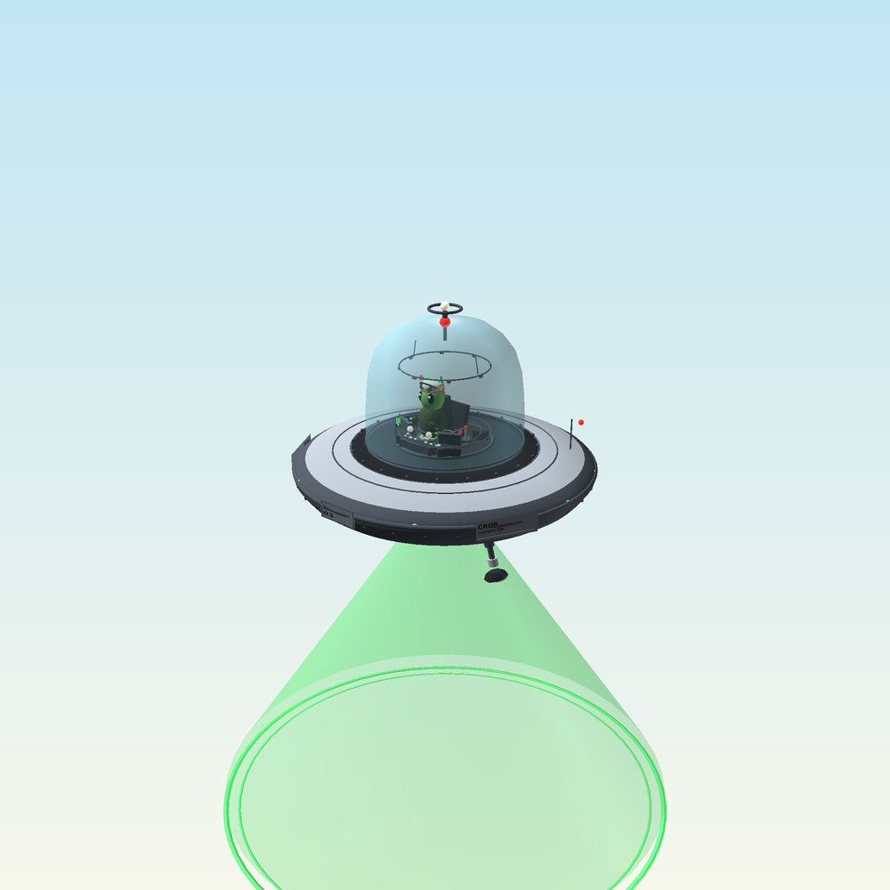

### Steuerung

Alle Tasten kannst du unter **Optionen → Steuerung** ändern. Im Fahrzeug:

* **V** – abheben / landen; **Bild ↑ / Bild ↓** – Höhe steuern
* **Z** – Hauptstrahl an / aus
* **K** – durch die acht Strahl-Modi schalten
* **J / L** – Strahlbreite ändern; im Sä-Modus das Saatgut wechseln
* **O** – physisches Objekt am Hauptstrahl aufnehmen; **U** – freigeben oder
  virtuelle Ladung abladen; **B** – Ernte-Zweitstrahl an / aus
* **I** – Korntank endlos / normal; **M** – anklickbares Bordmenü öffnen

Der physische Objektstrahl verwendet dieselben Grenzen wie beim UFO 2000: höchstens
12.000 kg und 4,5 × 4 × 8 m. Die Offline-Smoke-Tests bestehen; tatsächliche
Physik, Kollisionen und Multiplayer müssen noch im FS25 getestet werden.

Das HUD zeigt Höhe, Modus, Strahlzustand, Tank- und Laderauminhalt sowie den
Transferstatus. Das Cockpit zeigt rechts das Muster-Rad mit Zeiger, links die
Modus-Tafel, dazu ein Hologramm über dem Pult. Zorp wippt beim Schweben mit dem
Kopf und verschwindet, sobald du einsteigst – dann sitzt dort dein eigener Charakter.

### Kornkreise

Im **Bordmenü (`M`)** wählst du links eine Form; `Bild ↑ / ↓` blättert durch die
Muster. Der letzte Eintrag ist der **freie Stift**: mit `J` / `L` stellst du den
Radius in 50-cm-Schritten ein und malst die Figur selbst, während du fliegst.
Die anderen Einträge sind fertige Geometrien (Ring, Dreifachring, Spirale,
Blume, Stern, Alien, Blume des Lebens, Sonne), die der Strahl von allein ins Feld
drückt. Ertrag geht dabei nicht verloren – der Strahl drückt die Frucht platt.

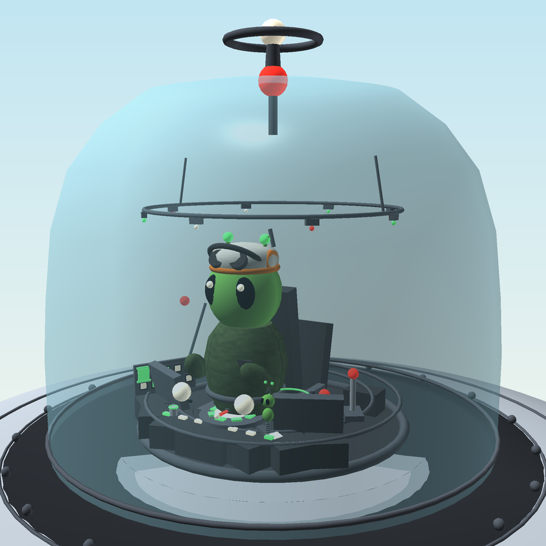

### Bauen und prüfen

```bash
python tools/build_crop_harvester_mod.py     # Modell, Texturen, Ton, XML, ZIP
python tools/ufo/validate_crop.py            # statische Prüfung ohne Spiel
python tools/ufo/luatest_crop.py             # Lua-Testflug ohne Spiel
```

Der Mod ist **eigenständig** – er braucht weder das UFO 2000 noch den Alien-Mod
und kann parallel zu beiden installiert werden (`FS25_CropHarvester` hat eine
eigene Specialization `cropHarvester`, eine eigene Lua-Kopie und eigene
`crop_*`-Tasten).

### Was dabei am UFO 2000 repariert wurde

Beim Bauen ist aufgefallen, dass der **Traktorstrahl in allen bisherigen
Untertassen unsichtbar war**: Das Modell benutzte ein generisches Strahl-Mesh
und schrieb pro Modus nur den Materialnamen um – beim Export entstanden dadurch
leere Shapes ohne Material. `tools/ufo/model.py` ordnet die Geometrie jetzt dem
Material des Nodes zu, deshalb haben **UFO 2000, UFO 2500, UFO 4500 und der
Crop Harvester** wieder einen sichtbaren, farbigen Strahl.

## 9. Baba Jagas Hühnerhütte (Konsolen-tauglich)

Ein aufstellbarer **Hühnerstall** der anderen Art: eine Blockhütte auf einem
riesigen Hühnerbein, mit Schindeldach, krummem Schornstein, Laterne, zwei
Futertrögen, einem Schild **„BABA JAGA"** und einem eingelegten Hühnerhof.

Das Bein ist ein richtiges Vogelbein: ein Federrock aus fünf Lagen langer
Federn, ein geschuppter Schaft mit überlappenden Platten, ein dickes
Sprunggelenk und drei Zehen nach vorn plus einer nach hinten – jede Zehe ein
durchgehendes Rohr mit einer Kralle, die sich in den Boden krallt. Auf den
Zaunecken sitzen **Vogelschädel** auf Pfählen, das Schild ist ein bemaltes
Brett mit der Aufschrift.

| | |
| --- | --- |
| Preis | 18.500 €, 12 €/Tag Unterhalt |
| Hühner | 20 Plätze, ausbaubar bis 60 |
| Futter | 2.500 l in zwei Trögen (Weizen u. a.) |
| Eier | bis zu 6 Paletten am Palettenplatz |
| Zaun | im Modell enthalten, als Grundspiel-Hühnernetz |
| Shop | Tiergehege → Hühner |

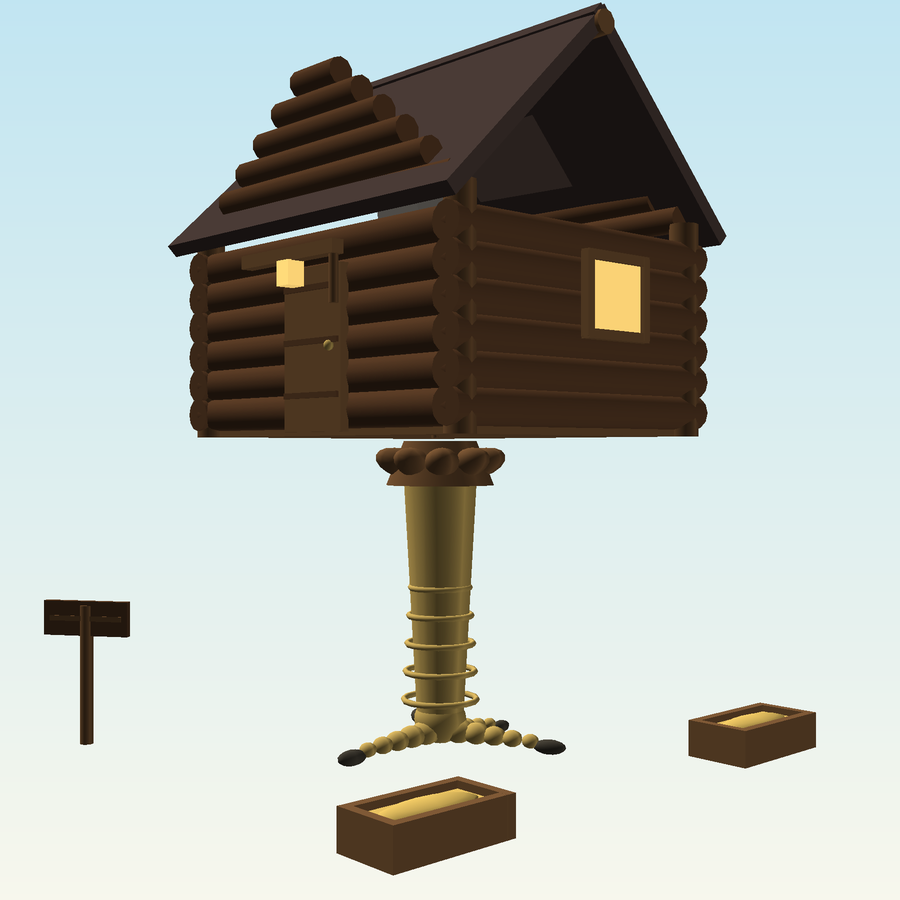

**So benutzt du sie**

1. Im Shop unter **Tiergehege** kaufen und aufstellen (Gelände wird geebnet,
   Boden freigeräumt, Gras eingesät).
2. Weizen in den Futter-Trigger vor den Trögen kippen – die Tröge füllen sich
   sichtbar, die Hühner laufen automatisch hin.
3. Hühner beim Tierhändler kaufen und einsetzen, Eier sammelst du am
   Palettenplatz ab.

**Warum das auf Konsole läuft:** Die Hütte ist ein ganz normaler
`chickenHusbandry`-Placeable des Grundspiels, also dieselbe Technik wie der
gekaufte Hühnerstall – kein Lua, keine eigenen Specializations, Marke Lizard.
Der Zaun ist keine Zusatzdatei, sondern ein Kontur-Satz im Modell: aus den vier
Eckpunkten baut das Spiel das Laufnetz für die Hühner selbst.

Die Hütte **läuft nicht** durch die Gegend, sie steht auf ihrem Bein. Bewusst so:
ein Bein mit Animation wäre ein eigenes Skript und damit auf Konsole nicht
erlaubt.

```bash
python tools/build_babajaga_mod.py       # Modell -> Texturen -> XML -> ZIP
python tools/babajaga/validate.py        # Prüfung ohne Spiel
```

## 9b. Baba Jagas Wohnhütte (separates, konsolenfreundliches Haus)

`FS25_BabaJagaHouse` ist ein **zusätzlicher Wohn-Placeable**; die Hühnerhütte
`FS25_BabaJaga` bleibt der unveränderte Hühnerstall. Die Hütte steht ebenfalls
auf dem großen Vogelbein, ist aber als Haus mit Innenraum gebaut.

* Eine echte, steile Holztreppe mit einzelnen Kollisionsstufen führt zur erhöhten
  Hütte — kein Teleport. Der obere Balkon ist begehbar und an die Treppe
  angeschlossen.
* Die Eingangstür lässt sich über die native FS25-AnimatedObject-Funktion öffnen.
* Im Haus sind ein Schlaf-Trigger und eine Garderobe zum Kleidungwechseln
  eingebaut; beide verwenden die nativen Farmhouse-/Wardrobe-Placeable-Tags.
* Das Mod-Paket enthält **kein Lua und keine eigenen Input-Actions**. Die
  Interaktionen beruhen auf Grundspiel-Placeable-Funktionen und sind für
  Konsolen vorgesehen.

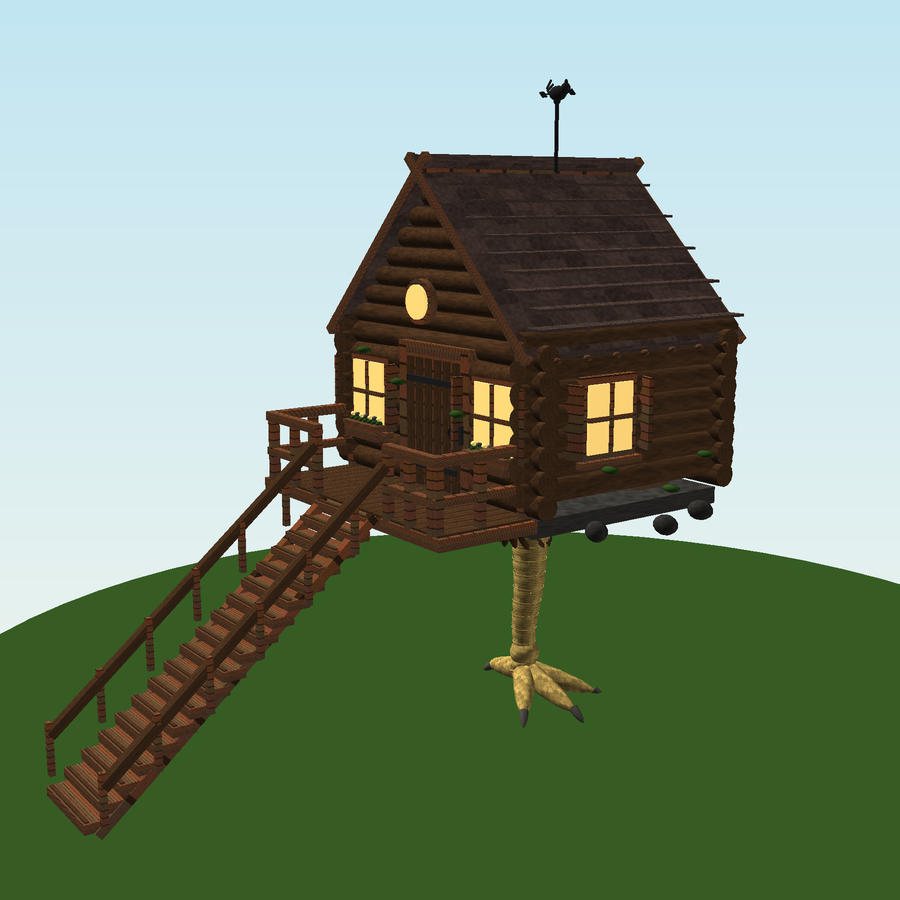

Preis: **28.500 €**, Unterhalt **18 €/Tag**. In den Shop-Kategorien unter
**Farmhäuser** separat aufstellen. Die XML-/Modellprüfung ist statisch möglich;
Türanimation, Treppenbegehbarkeit sowie Schlafen/Garderobe wurden noch nicht in
einer laufenden FS25-Instanz getestet.

```bash
python tools/build_babajaga_house_mod.py
python tools/babajaga/validate_house.py
```

## 10. Die Hofdisco (`FS25_Disco`)

Eine aufstellbare Disco-Halle mit Neonlicht, drehender Spiegelkugel, DJ-Pult,
Theke, Tischen und Schachbrett-Tanzfläche – vor allem aber mit **gemeinsamer
Musik**: alle, die drin sind, hören dasselbe Stück ab derselben Sekunde.

| | |
| --- | --- |
| Preis | 32.000 €, 25 €/Tag Unterhalt |
| Musik | 6 eigene Stücke (Disco, Techno, Chill, Country, Grusel, Western) |
| Tasten | `N` = nächster Titel, `M` = Musik an/aus (Gamepad: Y / X) |
| Shop | Platzierbare Objekte |
| MP | ja, Server entscheidet Titel und Startzeit |

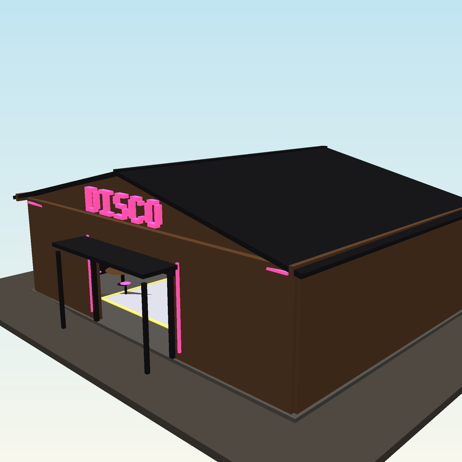
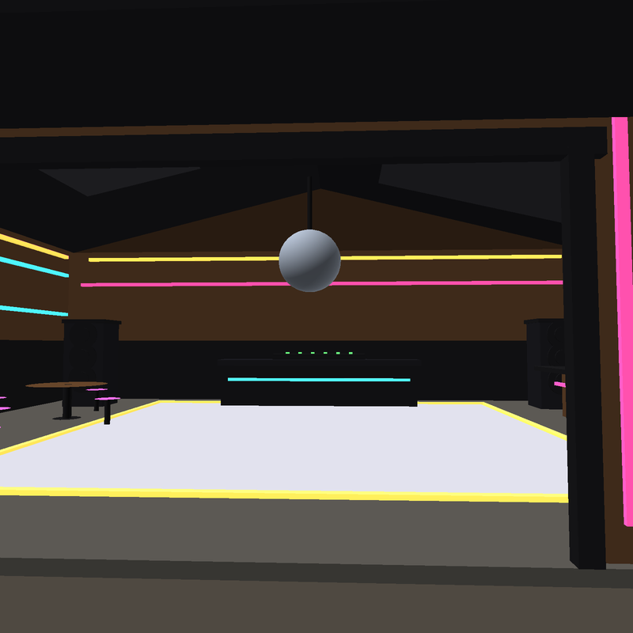

**So funktioniert die gemeinsame Musik**

* Der Titel ist **kein Stream**, sondern eine OGG-Datei im Mod. Abgespielt wird
  sie als 3D-Sound an der Spiegelkugel: wer in der Halle steht, hört sie laut,
  wer draußen ist, hört sie leiser (bzw. gar nicht).
* Drückt jemand `N`, schickt sein Spiel nur einen **Wunsch** an den Server
  (`DiscoStateEvent`). Der Server wählt den Titel, setzt die Startzeit auf
  „jetzt + 1,5 s" und schickt genau diese Zeit an alle.
* Jeder PC startet die Datei mit der Verzögerung `Startzeit − eigene Zeit`. Damit
  läuft der Song auf allen Rechnern im selben Takt – auch der Blink der
  Neon-Gruppen und die drehende Kugel hängen an dieser Zeit, nicht an einem
  lokalen Timer.
* Kommt jemand später in die Halle, bekommt er beim Verbinden den aktuellen
  Zustand (`track`, `playing`, `startTime`) und steigt mittendrin ein.

**Titel austauschen:** `FS25_Disco/sounds/discoSounds.xml` öffnen, eigene
OGG-Datei nach `sounds/` legen und eine weitere `<music7 .../>`-Zeile eintragen
(bis zu 8 Stück, `bpm` steuert das Blinken). Kein Neubauen des Mods nötig.

```bash
python tools/build_disco_mod.py                    # Modell, Texturen, Musik, ZIP
python tools/venue/validate.py --mod disco         # Prüfung ohne Spiel
```

## 11. Der Club: Distillery Leipzig (`FS25_Distillery`)

Nachgebaut nach dem Grundriss aus der Vorlage – **innen und außen getrennt**, so
wie im Plan eingezeichnet: eine alte Backsteinfabrik mit **Turm** und
Satteldach, Hauptfloor 20 × 15 m, Bar-Flügel 15 × 15 m und ein **Außenbereich
(Garten) 14 × 18 m** – mit **„DISTILLERY / LEIPZIG"** als Leuchtschrift über dem
Eingang, Graffiti an der Fassade und Kopfsteinpflaster auf der Straße.

| | |
| --- | --- |
| Preis | 185.000 €, 180 €/Tag Unterhalt |
| Musik | 6 eigene Club-Tracks (Techno, Deep House, Hard, Minimal, Acid, Closing) |
| Tasten | `N` = nächster Titel/Sender, `M` = Musik an/aus, `R` = Quelle PA ↔ Radio (Gamepad: Y / X / L3) |
| Shop | Platzierbare Objekte |
| MP | ja, Server verwaltet Titelliste und Startzeit |

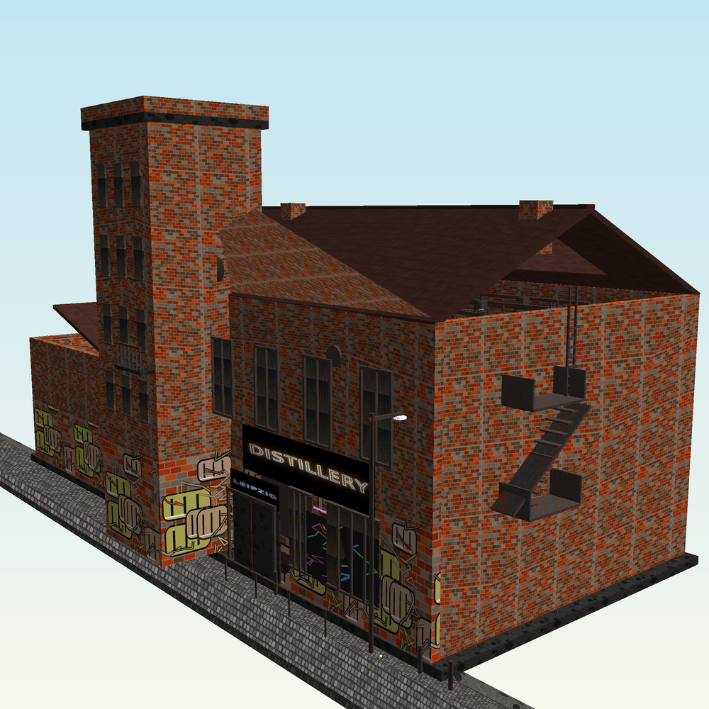
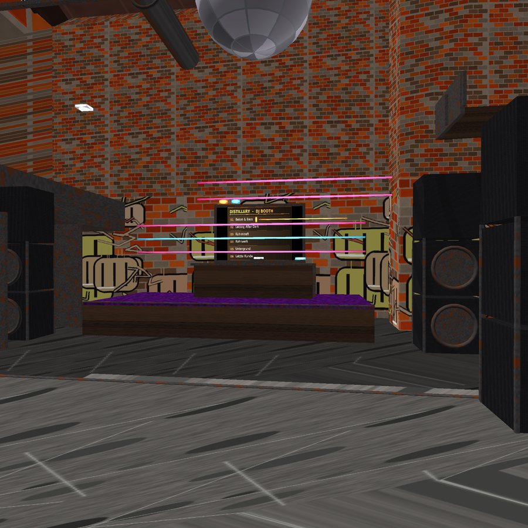
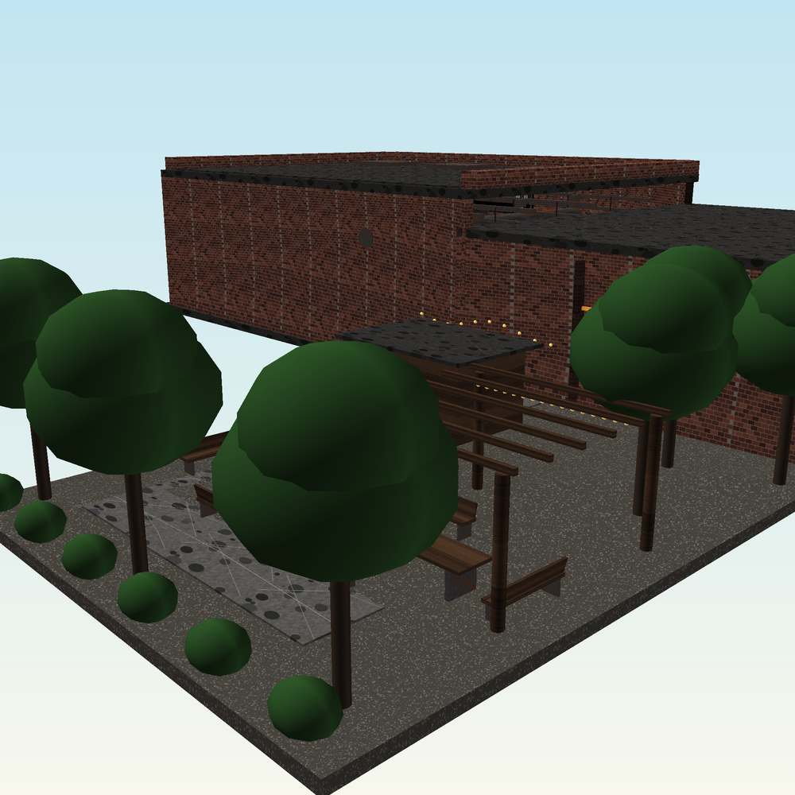

**Was aus dem Grundriss drin ist**

* **Innen – Hauptfloor (20 × 15 m)**: DJ-Pult auf einer Bühne, **vier große
  PA-Türme** (je zwei Bässe und vier Hörner, ca. 3,7 m hoch) links und rechts der
  Tanzfläche, Traversen mit acht Moving Heads, Neonbänder, Spiegelkugel,
  Beton-Tanzfläche mit **Blüten-Decal**, vier tragende Säulen mit Unterzug,
  Lüftungskanäle.
* **Innen – Flügel (15 × 15 m)**: **Hauptbar** mit langer Theke, Zapfhähnen,
  Rückwandregalen und LED unter der Theke, dazu eine **VIP-Empore im 1. OG** mit
  Brüstung, Blick auf die Tanzfläche und eigener Treppe.
* **Innen – drumherum**: **Foyer/Kasse** mit Garderobentheke und Drehkreuz,
  **Sanitärbereich**, **Lagerraum**, **Treppe ins 2. OG**, **Feuerleiter** über
  das Dach.
* **Außen – Garten (14 × 18 m)**: Barhütte **„BAR 01"** mit Flaschenregal und
  Tresen, **acht Bistro-Sitzgruppen**, **zwei überdachte Bereiche** (Pergola mit
  Segeltuch), **zwei Chill-out-Ecken** mit Sofas und Kistentisch, Steinweg,
  Bäume und Sträucher, Lichterketten.
* **Gebäude in der Totalen**: roter Klinker mit Graffiti-Band, **Turm mit
  Balkon (ca. 18,5 m)**, Satteldach mit **gemauerten Dreiecksgiebeln** und rundem
  Giebelfenster, Dachgauben, Leuchtschrift, „EST. 2018".

**Die Titelliste am DJ-Pult (das Kernstück)**

Am Pult hängt ein beleuchtetes Set-List-Board. Es zeigt alle sechs Tracks,
darunter läuft ein amberfarbener Marker mit – er steht immer an der Zeile des
Titels, der gerade läuft. Wer an den Mixer tritt (ca. 4,5 m Radius), bekommt
die Tasten eingeblendet und kann selbst weiterschalten. Das Board ist Teil des
Modells (Textur + Marker-Knoten `playlistMarker`), der Marker wird vom Skript
nur eine Zeile nach unten gesetzt – deshalb sieht auch der Nachbar im Club,
was läuft.

**Wie die Musik für alle gleich läuft**

Das ist derselbe Mechanismus wie in der Hofdisco, nur mit größerer Anlage:

1. Der Titel ist eine **OGG-Datei im Mod**, kein Stream. Abgespielt wird sie als
   3D-Sound am `musicNode` mitten in der Halle – laut an der Tanzfläche, leise
   draußen. Die PA-Türme sind Modell + Position, sie sind kein eigener Audiopfad.
2. `N` schickt nur einen **Wunsch** an den Server (`DistilleryStateEvent`). Der
   Server wählt Titelnummer + Startzeit („jetzt + 1,5 s") und schickt beides an
   alle. Jeder PC startet die Datei mit `Startzeit − eigene Zeit`.
3. Neonblinken und Marker hängen an derselben Netzwerkzeit, nicht an einem
   lokalen Timer. Wer später dazukommt, bekommt beim Verbinden den Zustand und
   steigt mittendrin ein.

**Ehrliche Grenzen bei Streams (wichtig)**

Der Wunsch war „ein Stream ins Spiel" – SoundCloud, MP3-Datei, Internetradio-URL.
Was davon technisch geht:

| Quelle | Geht das? | Wie |
| --- | --- | --- |
| MP3-Datei | **nur als OGG** | FS25 lädt OGG Vorbis (und WAV). MP3 vorher umwandeln, Datei nach `sounds/`, Zeile in `sounds/distillerySounds.xml` ergänzen (bis 8 Titel, `bpm` steuert das Blinken). Läuft dann synchron für alle. |
| Playlist | **ja** | Genau das ist die Titelliste: mehrere Einträge in derselben XML, am Pult umschaltbar. |
| SoundCloud | **nein** | Lua im Spiel hat keine URL-/HTTP-Funktion; `createSample` nimmt nur Dateinamen. Ein Mod kann keinen SoundCloud-Link öffnen. Nur wenn ein direkter Audio-Stream-Link existiert, geht er über das Spielradio (nächste Zeile). |
| Internetradio-URL | **ja, als zweite Quelle am Pult** | Sender in die Profildatei `streamingInternetRadios.xml` eintragen (`<streamingInternetRadio href="…"/>`, mp3/aac/m3u/pls) – Anleitung mit Pfaden und Beispiel in [`docs/streaming_radio.md`](docs/streaming_radio.md). Am DJ-Pult schaltet `R` die **Quelle** um: PA ↔ Club-Radio. Im Radio-Modus wechselt `N` die Sender, `M` pausiert. **Das gilt pro Spieler** – die Club-PA läuft für alle anderen weiter. Echtes „ein Stream für die ganze Disco" ist von außen nicht möglich. |

**Die Quelle am Pult**

Am Set-List-Board sitzen zwei kleine Lampen: **amber = Club-PA** (synchron),
**cyan = Club-Radio** (dein Stream). `R` schaltet um, im Radio-Modus zeigt die
Bildschirmmeldung den Sendernamen, der Marker am Board pausiert. Damit ist das
Internetradio kein Sonderweg mehr, sondern einfach der zweite Eintrag in der
Auswahl am Mixer – nur eben lokal für den Spieler, der davor steht.

Kurz: **synchron und für alle** ist die eingebaute Playlist. Externe Streams
bleiben ein Angebot an den einzelnen Spieler über das Spielradio.

```bash
python tools/build_distillery_mod.py                # Modell, Texturen, Musik, ZIP
python tools/venue/validate.py --mod distillery     # Prüfung ohne Spiel
```

## 12. Das Autokino (`FS25_Autokino`)

13-m-Leinwand, Vorführhäuschen, 24 Parkbuchten mit Radstoppern, Lampenmasten –
und drei kurze Zeichentrickfilme, die wirklich laufen.

| | |
| --- | --- |
| Preis | 48.000 €, 35 €/Tag Unterhalt |
| Filme | Der kleine Traktor, UFO über dem Hof, Der Alien |
| Bildrate | 16 Einzelbilder je Film, 6 Bilder/s, Endlosschleife |
| Ton | eigener Soundtrack je Film (Country / Techno / Chill) |
| Tasten | `F` = nächster Film, `P` = Film an/aus (Gamepad: Y / X) |
| MP | ja, Bildnummer wird aus der Netzwerkzeit berechnet |

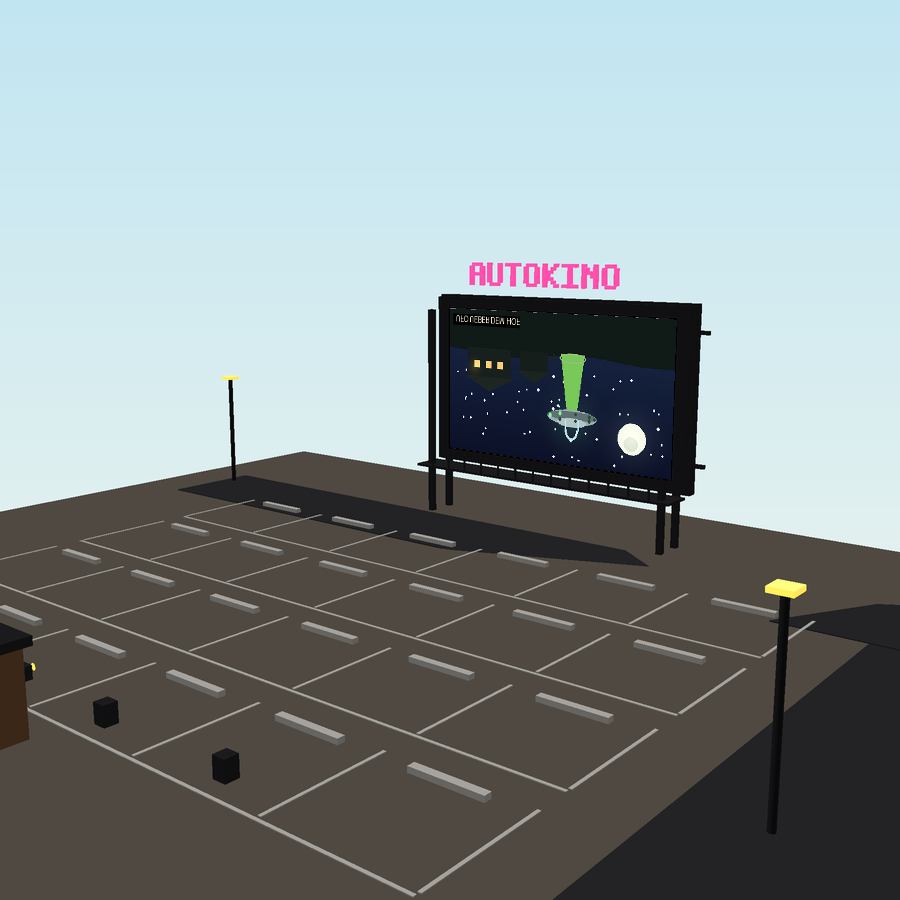
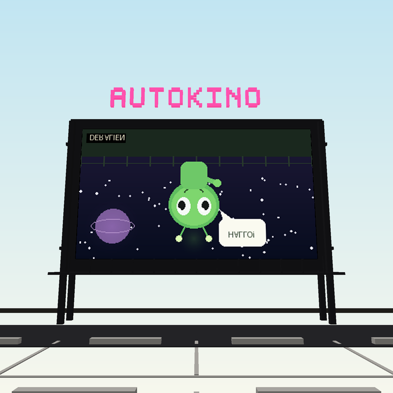

**Warum Bildersequenz statt Video**

FS25 kann aus Lua keine Videodatei dekodieren – es gibt keine Video-Textur-API.
Also ist jeder Film eine Reihe von 16 DDS-Texturen, die das Skript im
Sekundentakt auf das Material der Leinwand legt (`setMaterialDiffuseMapFromFile`).
Das ist genau die Technik, die das Grundspiel für Werbeplakate benutzt, kostet
keinen Videocodec und läuft auf jedem PC.

**Warum das im Multiplayer synchron bleibt**

Die Bildnummer ist keine lokale Zählung, sondern wird **berechnet**:
`frame = (Netzwerkzeit − Startzeit) × 6`. Server und Client rechnen dieselbe
Formel auf derselben Zeitbasis, deshalb zeigen alle Bildschirme dasselbe Bild –
auch wenn jemand mitten im Film dazukommt. Der Ton nutzt dieselbe Startzeit,
also passt Musik und Bild zusammen.

**Eigene Filme:** Bilder als `key_00.dds` … `key_15.dds` nach `textures/film/`
legen und in `sounds/autokinoSounds.xml` eine `<film .../>`-Zeile ergänzen
(bis zu 6 Filme, 32 Bilder). Die Bilder müssen 16:9 haben, z. B. 320×180.

```bash
python tools/build_autokino_mod.py                 # Modell, Filme, Ton, ZIP
python tools/venue/validate.py --mod autokino      # Prüfung ohne Spiel
```

## 12b. Schnelltest – was ich zuerst anschauen würde

Die Mod-ZIPs aus `dist/` in den Mods-Ordner legen, Spiel starten, dann in dieser
Reihenfolge:

1. **Shop → Platzierbare Objekte → Deko**: Alien 1.3.0.0 (750/1.200/1.500 €) –
   die drei Figuren sind neu modelliert (kein Kugelbaukasten mehr): Eiform-Schädel
   mit Lidern, Hände mit Fingern, Socken mit Bund, Helm mit Ohrmuscheln und
   Brillengläsern. Am besten einmal dicht rangehen.
2. **Shop → Fahrzeuge**: UFO 4500 2.0.0.0 (185.000 €) kaufen – **ohne**
   Schneidwerk. Abheben, `K` bis GRÜN, `Z`: der Strahl erntet. Dabei auf die
   wandernden Ringe im Strahl achten. Danach UFO 01 Crop Harvester 1.2.0.0:
   gleiche Übung, nur kleiner – der Rumpf ist jetzt glatt, ohne Anbauplatten.
3. **Shop → Platzierbare Objekte → Distillery 1.1.0.0** (185.000 €) aufstellen,
   um das Haus laufen (Turm, Graffiti, Feuerleiter) und dann **durch den Garten**
   gehen: Barhütte, Sitzgruppen, zwei Pergolen, zwei Chill-out-Ecken.
4. **Baba Jaga 1.1.0.0** (18.500 €) als Hühnerstall aufstellen: Bein, Schild,
   Schädel auf den Zaunpfählen; Weizen in den Trigger, Hühner einsetzen.
5. **Baba Jaga's Home 1.0.0.0** (28.500 €) separat unter Farmhäuser aufstellen;
   die Treppe und den Balkon begehen, die Tür öffnen, Schlaf- und Garderoben-
   Trigger prüfen. Das ist noch ein Ingame-Test, keine bestätigte Prüfung.
6. **Höhensturm 1.2.0.0** (1.650.000 €) auf großer freier Fläche platzieren;
   am Bahnhof mieten, vorne links einsteigen und die beiden Überschläge sowie
   die Spiralpassage testen. Mit drei Mitfahrern auf anderen PCs zusammenfahren.
   PC-only: Lua ist nötig, daher nicht auf Konsole.

Wenn etwas nicht lädt oder komisch aussieht: `log.txt` schicken, Zeilen mit dem
Mod-Namen. Die Mods-Ordner im Spiel heißen wie die Zips (`FS25_Distillery` usw.).

## 12c. Höhensturm — Inversions-Achterbahn (`FS25_Hoehensturm`)

PC-only, große Achterbahn mit echter Roll-Ausrichtung: ein aufsteigender
1,5-facher Spiralabschnitt, zwei vollständige vertikale Loopings und 55,5 m
Höhenunterschied. Der gemeinsame Wagen hat vier Plätze in 2×2: Fahrer vorne
links, drei Mitfahrer nebendran und dahinter. Im Multiplayer können die Spieler
denselben Wagen nutzen; alle PCs brauchen den Mod. Der Fahrer startet manuell
am Bahnhof; sobald sich der Wagen bewegt, fährt er eine vollständige Runde
automatisch zurück. Während der Fahrt sind Bremsen, Rückwärtsfahren und Aussteigen
gesperrt; erst am Bahnhof nach dem Stillstand wird wieder freigegeben. Die
verglaste Bahnhofshalle erhält cyan/violette LED-Lichttunnel an Loopings und
Spirale, wenige echte Lichtquellen sowie eine eigens erzeugte Motor-, Start-/Stopp-
und Fahrtwind-Soundkulisse.

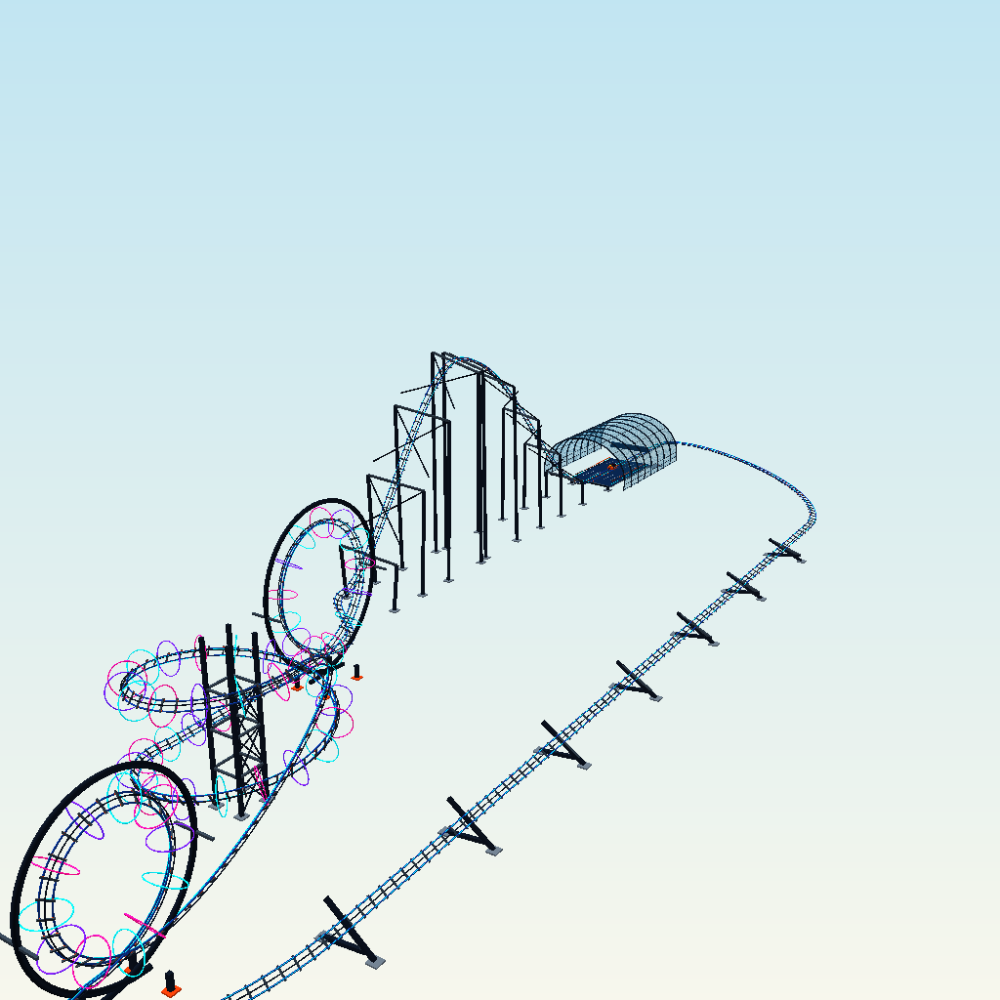
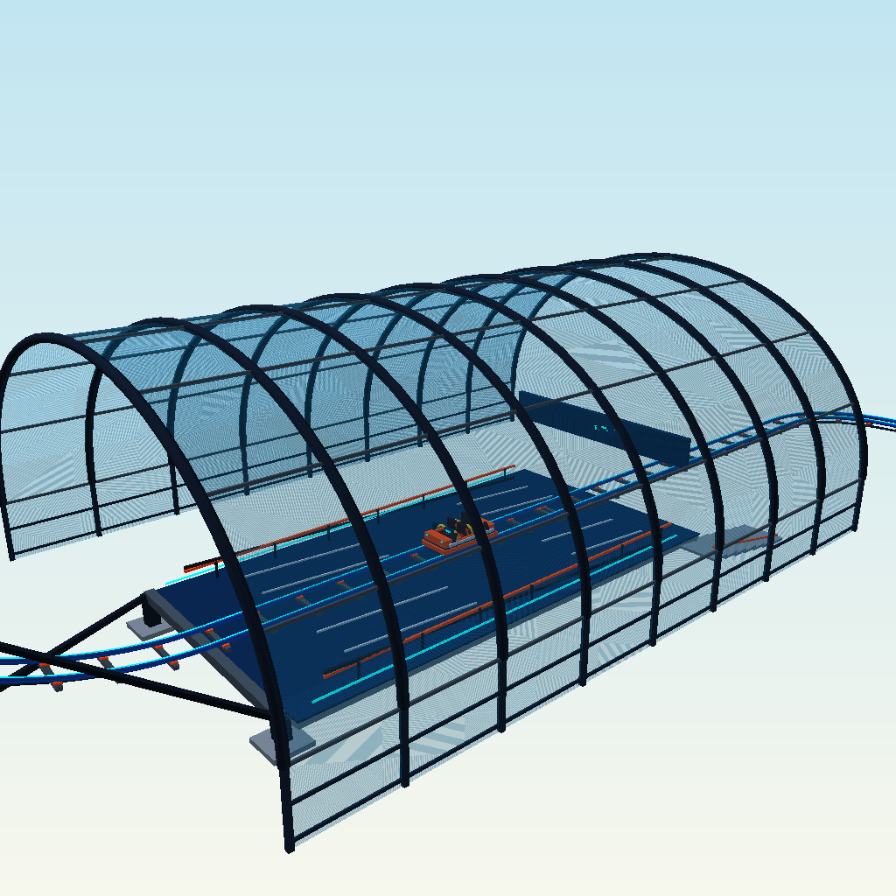
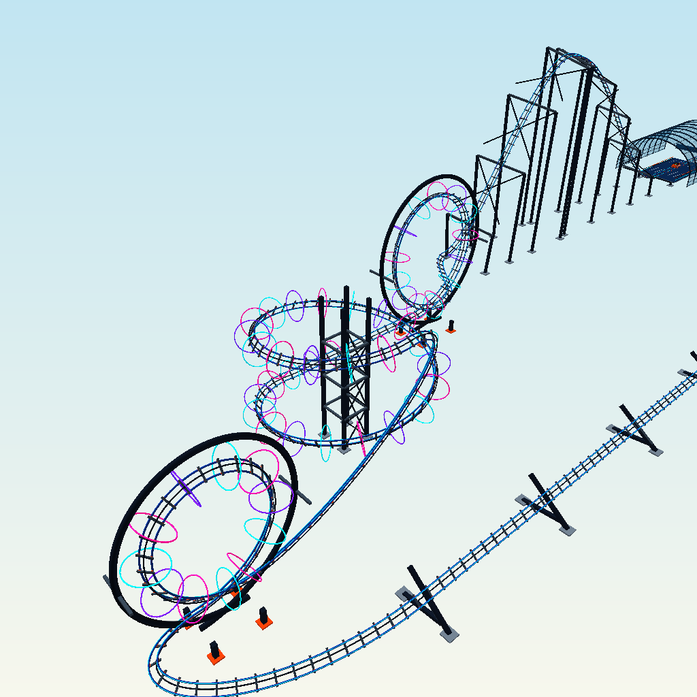

| | |
| --- | --- |
| Höchstgeschwindigkeit | 120 km/h |
| Höhenprofil | 2,5 m bis etwa 58 m |
| Sitze | 1 Fahrer + 3 Mitfahrer, 2×2 |
| Steuerung | Manuell am Bahnhof starten; danach automatische Runde ohne Bremse |
| Aussteigen | Während der Runde gesperrt, Freigabe erst bei Stillstand am Bahnhof |
| Atmosphäre | Glashalle, LED-Tunnel an den Inversionen, cyan/violette Lichter und Original-Sound |
| Plattform | PC-only; Lua für Roll-Ausrichtung und Runden-/Ausstiegssperre |

```bash
python tools/build_rollercoaster_mod.py       # Modell, Roll-Spezialisierung, ZIP
python tools/coaster/luatest.py               # Lua-Roll-Smoke-Test (benötigt Lupa)
```

Das Placeable braucht etwa 180 × 370 m freie Fläche. Der native FS25-TrainSystem
übernimmt Fahrt, Miete und Netzwerksynchronisierung; `CoasterRoll.lua` ergänzt
den geschlossenen, rollenden Rahmen und sperrt nach dem Start die Eingriffe sowie
die Fahrer- und Mitfahrerausstiege bis zum Halt am Bahnhof. Jeder Mitfahrer kann
danach selbst aussteigen. Bei Verbindungsabbruch bleiben FS25s native Player-/Sitz-
Aufräumwege aktiv; steigt der Fahrer aus oder wird getrennt, setzt Lua die Fahrt
zum Bahnhof fort, statt den Zug durch eine blockierte Leave-Funktion einzufrieren.

## 12d. Handbücher als PDF (`docs/pdf/`)

Neun Mods haben ein eigenes deutsches Handbuch im selben Aufbau: Deckblatt mit
Render, „Was ist das?“ mit Bildern **aus dem Spiel** und den **Vorlagen**, nach
denen gebaut wurde, Bedienung als Tastentabelle, „Worauf du achten solltest“,
Kompatibilität (PC / Konsole / Multiplayer) und technische Daten. Für die neue
Wohnhütte und Höhensturm gibt es derzeit noch kein separates PDF-Handbuch.

| PDF | Inhalt |
| --- | --- |
| `docs/pdf/FS25_UFO2000.pdf` | Untertasse, 8 Strahl-Modi, Cockpit |
| `docs/pdf/FS25_Alien.pdf` | die drei Figuren, neues Gesicht, Zorp |
| `docs/pdf/FS25_UFO2500.pdf` | Konsolen-Edition ohne Lua, Pinselbreiten |
| `docs/pdf/FS25_UFO4500.pdf` | Mutterschiff, Strahl-only, 2 Mio. l Tank |
| `docs/pdf/FS25_CropHarvester.pdf` | UFO 01, Kuppel, Kornkreise |
| `docs/pdf/FS25_BabaJaga.pdf` | Hühnerhütte auf dem Vogelbein |
| `docs/pdf/FS25_Disco.pdf` | Hofdisco, synchronisierte Musik |
| `docs/pdf/FS25_Autokino.pdf` | Leinwand, Filme, MP-Sync |
| `docs/pdf/FS25_Distillery.pdf` | Club nach Grundriss, Titelliste, Radio |

```bash
python tools/build_manuals.py                  # alle neun
python tools/build_manuals.py --only UFO4500   # nur eines
```

Die Inhalte stehen als Datenblöcke oben in `tools/build_manuals.py` (Titel,
Preis, Bilder, Tastentabelle, Tipps, Kompatibilität, technische Daten) – ein
Textwunsch ist eine Zeile dort und ein neuer Lauf.

## 13. Ehrlicher Hinweis

Getestet ist alles, was ohne Spiel geht – **im echten FS25 lief es noch nicht**
(hier ist keins installiert). Wenn etwas klemmt, hilft die `log.txt`; Zeilen mit
„UFO2000", „UFO2500", „UFO4500", „BabaJaga", „BabaJagaHouse", „Alien", „Disco", „Distillery", „Autokino", „CropHarvester" oder „CoasterRoll" zeigen die Stelle, dann bessere ich gezielt nach.

Beim UFO 2500 sind drei Dinge die ersten Kandidaten für Feinschliff, falls es im
Spiel komisch aussieht: die Fahrhöhe (Federn/Dämpfer der unsichtbaren Räder,
`spring`/`damper` in `ufo2500.xml`), die Standfestigkeit (Breite der beiden
Räder und die Stützräder) und der Startwert der Lande-Animation. Alles lässt
sich in `tools/build_console_mod.py` bzw. `tools/ufo/ufo2500.template.xml` in
einer Zeile ändern und neu bauen.

Viel Spaß beim Schweben – und grüß Alf. 👽
